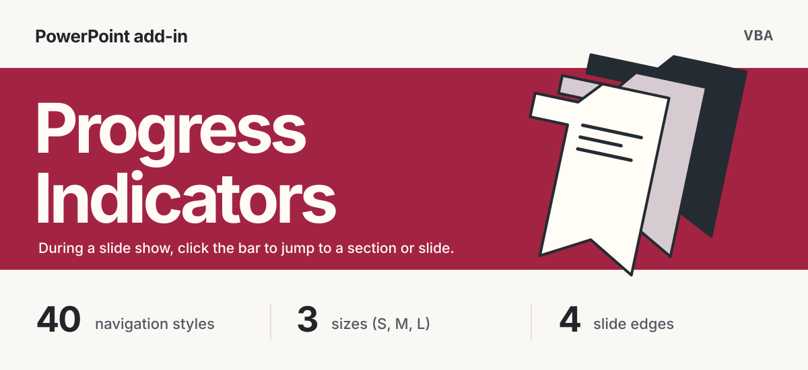
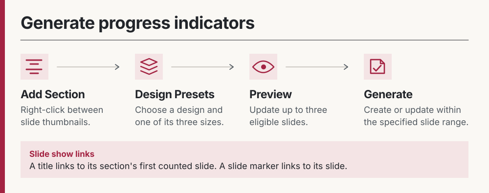
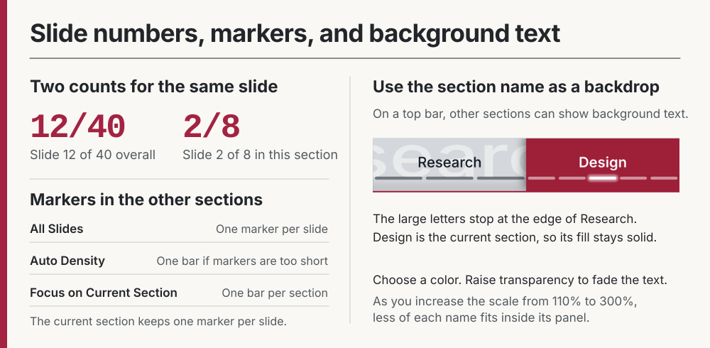
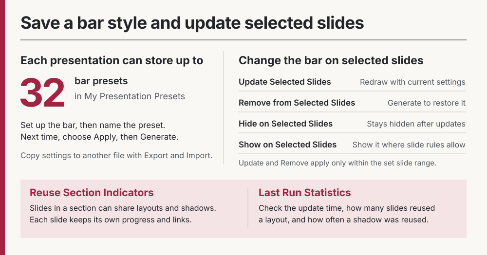
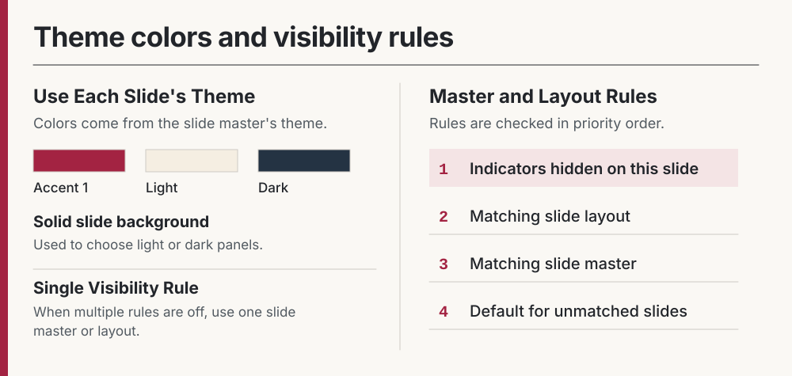
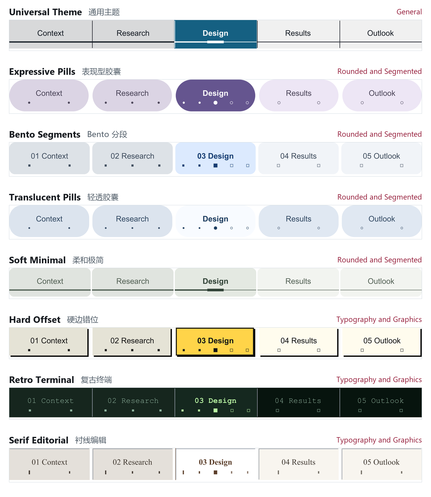

<p align="center"><strong>English</strong> / <a href="README.zh-CN.md" lang="zh-CN">简体中文</a></p>

<p align="center">
<a href="https://github.com/GH-X-ST/PowerPoint-Progress-Indicators/releases/download/EN.11.5/ProgressIndicators-EN.11.5.zip">
<picture>
  <source media="(prefers-color-scheme: dark)" srcset="docs/assets/badges/en-dark.svg" />
  <source media="(prefers-color-scheme: light)" srcset="docs/assets/badges/en-light.svg" />
  
</picture>
</a>
<a href="https://github.com/GH-X-ST/PowerPoint-Progress-Indicators/releases/download/CN.11.5/ProgressIndicators-CN.11.5.zip">
<picture>
  <source media="(prefers-color-scheme: dark)" srcset="docs/assets/badges/cn-dark.svg" />
  <source media="(prefers-color-scheme: light)" srcset="docs/assets/badges/cn-light.svg" />
  
</picture>
</a>
</p>

<picture>
  <source media="(prefers-color-scheme: dark)" srcset="docs/assets/hero-en-dark.svg" />
  <source media="(prefers-color-scheme: light)" srcset="docs/assets/hero-en-light.svg" />
  
</picture>

PowerPoint Progress Indicators turns a deck's sections and slide order into navigation you can click during a slide show. This is an independently maintained edition of Olaf Nöhring's Progress Indicator 1.960. The slide examples below were generated with the released 11.5 add-in in desktop PowerPoint for Windows.

[Tutorial](#tutorial) | [All 40 presets](#preset-gallery) | [Changes from upstream](#upstream) | [Build from source](#build)

## Tutorial

### Install the add-in and generate your first navigation bar

Download the English or Chinese ZIP above. Install the **`.ppam`**. Open the matching **`.pptm`** in PowerPoint if you want to inspect or edit the VBA project. [All releases](https://github.com/GH-X-ST/PowerPoint-Progress-Indicators/releases)

<picture>
  <source media="(prefers-color-scheme: dark)" srcset="docs/assets/workflow-en-dark.svg" />
  <source media="(prefers-color-scheme: light)" srcset="docs/assets/workflow-en-light.svg" />
  
</picture>

1. Extract the release ZIP for your language. In PowerPoint for Windows, choose **File > Options > Add-ins**. Under **Manage**, select **PowerPoint Add-ins**, click **Go > Add New**, and select the extracted `.ppam`. Use your organization's usual process for enabling VBA add-ins. Enable one language edition at a time. The English edition adds a **Progress Indicators** tab.
2. Open the presentation you want to use. In the thumbnail pane, right-click the space where a section should begin, choose **Add Section**, and name it. For example, divide your talk into Background, Methods, and Results. The add-in uses these names as navigation titles. A deck without named sections can still show slide markers. [Microsoft's guide to sections](https://support.microsoft.com/en-us/powerpoint/training/organize-your-powerpoint-slides-into-sections)
3. On the **Progress Indicators** tab, choose **Design > Design Presets**, expand a style, then choose **Large**, **Medium**, or **Small**. For example, find **Crimson Layers** under Layers. Use **Position and Visibility > Dock Edge** to choose an edge with space next to your existing slide title, logo, or footer.
4. In the **Generate** group, choose **Show All**. **Equal Sections** gives each of the three sections one-third of the available length. **Equal Slides** sizes each section by the number of slides that count. For sections with 2, 6, and 4 slides, the proportions are 2/12, 6/12, and 4/12. For a simpler display, choose **Sections Only** or **Icons Only**.
5. Choose **Slide Updates and Performance > Update Current Slide** to see the result on the slide you are editing. **Generate > Preview** updates the first three eligible slides in the specified range, or fewer if fewer qualify. Click **Generate** to update the full range, then save the presentation. Start the slide show and click a section title to jump to its first counted slide, or an individual marker to jump to that slide. Click **Generate** again after adding, deleting, or reorganizing slides or sections.

### Choose an edge and allocate space

Under **Position and Visibility > Dock Edge**, choose Top, Bottom, Left, or Right. Sidebar titles read horizontally, with markers running down the edge. Use **Sidebar Width (pt)** for longer names or **Design > Fill Dock Edge** to extend navigation across the available edge.

<picture>
  <source media="(prefers-color-scheme: dark)" srcset="docs/assets/native/docking-dark.webp" />
  <source media="(prefers-color-scheme: light)" srcset="docs/assets/native/docking-light.webp" />
  
</picture>

<details>
<summary>Compare Equal Sections and Equal Slides</summary>

The five sections contain 2, 3, 5, 2, and 2 slides. **Equal Sections** gives each section one fifth of the bar. With **Equal Slides**, the five-slide Design section occupies 5/14 of the bar.

<picture>
  <source media="(prefers-color-scheme: dark)" srcset="docs/assets/native/spacing-dark.webp" />
  <source media="(prefers-color-scheme: light)" srcset="docs/assets/native/spacing-light.webp" />
  
</picture>

</details>

### Choose panel sizes and slide markers

With top or bottom docking, Crimson Layers measures **13, 21.45, and 44.2 pt** in Small, Medium, and Large. All Small presets use 13 pt panels, 7 pt titles, and markers half as tall as Large. The first and last markers span the middle 90% of each section. Medium and Large panels are 30% taller than their 11.4 counterparts. Two thirds of the extra space goes on the title side and one third on the marker side. When enabled, the connecting strip defaults to 1 pt in all sizes. To apply the new dimensions in an existing deck, reselect the preset and size, then generate.

<picture>
  <source media="(prefers-color-scheme: dark)" srcset="docs/assets/native/sizes-dark.webp" />
  <source media="(prefers-color-scheme: light)" srcset="docs/assets/native/sizes-light.webp" />
  
</picture>

For example, Crimson Layers draws the current chapter and its 1 pt connecting strip as a single outline. Sections nearer the current chapter sit in front of those farther away. The current slide marker glows and the others use 70% transparency. Install Inter Medium and Inter SemiBold on the computers used to prepare and present the deck if you want the specified weights. [Inter font family](https://rsms.me/inter/)

Use **Progress Icons** for the three states' colors and transparency and **Sections and Fonts** for section type and size. For preset markers, choose **Rounded Bars > Marker Shape** to switch among short bars, ruler ticks, dots, and other forms. Adjust marker height, spacing, or the current-slide glow there. To use traditional shapes or custom pictures, clear **Use Preset Slide Markers**, then choose the icon shape under **Progress Icons**. In a dense section, oval markers adjust along the length of the section and retain their thickness.

<picture>
  <source media="(prefers-color-scheme: dark)" srcset="docs/assets/native/markers-dark.webp" />
  <source media="(prefers-color-scheme: light)" srcset="docs/assets/native/markers-light.webp" />
  
</picture>

### Fit titles and style the section panels

Under **Text and Lines > Long Titles**, choose **Shrink Text to Fit** or **End with Ellipsis**. This group also controls alignment, letter case, and section lines. Under **Design**, you can number sections or bold the current title.

<picture>
  <source media="(prefers-color-scheme: dark)" srcset="docs/assets/native/type-dark.webp" />
  <source media="(prefers-color-scheme: light)" srcset="docs/assets/native/type-light.webp" />
  
</picture>

**Section Panels** controls panel colors, gradients, and text contrast. **Layered Navigation** controls chapter shadows, the strip that joins the current section, horizontal panel height, and shadow settings. With top docking, **Cropped Backdrop Text (Top)** can add an enlarged section name clipped to each inactive panel.

<picture>
  <source media="(prefers-color-scheme: dark)" srcset="docs/assets/native/surfaces-dark.webp" />
  <source media="(prefers-color-scheme: light)" srcset="docs/assets/native/surfaces-light.webp" />
  
</picture>

Under **Design**, set the current section accent's position, color, and weight. You can outline upcoming bars or match bars to the section text. **Section Panels** has separate transparency controls for the current, past, and upcoming sections and an **Auto Contrast for Text and Markers** option.

<details>
<summary>See all current section accents and nine section line settings</summary>

Choose **Design > Current Section Accent**. With top docking, the content edge is at the bottom of the panel, the outer edge is at the top, and the start edge is at the beginning of the section. The accent follows the dock edge.

<picture>
  <source media="(prefers-color-scheme: dark)" srcset="docs/assets/native/accents-dark.webp" />
  <source media="(prefers-color-scheme: light)" srcset="docs/assets/native/accents-light.webp" />
  
</picture>

For a boundary between sections, open **Text and Lines > Section Lines**, choose a divider, frame, or registration mark, and set the line width and color.

<picture>
  <source media="(prefers-color-scheme: dark)" srcset="docs/assets/native/section-lines-dark.webp" />
  <source media="(prefers-color-scheme: light)" srcset="docs/assets/native/section-lines-light.webp" />
  
</picture>

</details>

<details>
<summary>Compare numbering, alignment, upcoming markers, and automatic contrast</summary>

<picture>
  <source media="(prefers-color-scheme: dark)" srcset="docs/assets/native/type-and-states-dark.webp" />
  <source media="(prefers-color-scheme: light)" srcset="docs/assets/native/type-and-states-light.webp" />
  
</picture>

</details>

<details>
<summary>See the same preset follow a slide theme</summary>

Turn on **Position and Visibility > Use Each Slide's Theme**. Universal Theme takes Accent 1 and the light and dark colors from the slide's own theme. Picture and gradient backgrounds use theme colors. Crimson Layers uses fixed colors by default.

<picture>
  <source media="(prefers-color-scheme: dark)" srcset="docs/assets/native/theme-dark.webp" />
  <source media="(prefers-color-scheme: light)" srcset="docs/assets/native/theme-light.webp" />
  
</picture>

</details>

### Show counts and manage long decks

Under **Counts and Density > Progress Count**, choose an overall or section count, a percentage, or both counts. **Marker Density > Focus on Current Section** keeps individual markers in the current section and summarizes each other section. **Auto Density** summarizes an inactive section when individual markers would be shorter than **Minimum Marker Length (pt)**. The count uses the same eligible slides at every density.

The example below has 61 slides. The same slide remains the third in Design in all three views. Watch the markers in the surrounding sections as density changes.

<picture>
  <source media="(prefers-color-scheme: dark)" srcset="docs/assets/native/density-dark.webp" />
  <source media="(prefers-color-scheme: light)" srcset="docs/assets/native/density-light.webp" />
  
</picture>

<details>
<summary>See the counter formats and backdrop layers</summary>

<picture>
  <source media="(prefers-color-scheme: dark)" srcset="docs/assets/native/counts-dark.webp" />
  <source media="(prefers-color-scheme: light)" srcset="docs/assets/native/counts-light.webp" />
  
</picture>

<picture>
  <source media="(prefers-color-scheme: dark)" srcset="docs/assets/details-en-dark.svg" />
  <source media="(prefers-color-scheme: light)" srcset="docs/assets/details-en-light.svg" />
  
</picture>

</details>

### Update, remove, or hide navigation

The first and last slide fields in the **Generate** group limit where the add-in draws or removes navigation. The range applies to the current session. If you want to make several changes together, turn off **Auto Update**, adjust the settings, then click **Generate**.

| Situation | Action and result |
| --- | --- |
| Redraw only a few slides | Select their thumbnails in Normal view or Slide Sorter, then choose **Slide Updates and Performance > Update Selected Slides**. It updates selected slides within the configured range. Progress still counts the whole eligible deck. |
| Clear generated navigation temporarily | **Remove from Selected Slides** removes navigation from selected slides within the range. **Generate > Remove** removes it throughout the range. Both keep the settings, so a later generation can restore it. |
| Count a cover slide but keep navigation off it | Select the cover and click **Hide on Selected Slides**. This removes its navigation immediately and saves the slide-specific choice. **Show on Selected Slides** restores eligibility and redraws where the range and visibility rules allow. |
| Exclude a cover from progress, or hold progress steady during a build | In **Current Slide**, choose **Skip** or **Repeat**, and enable **Exclude > Skipped/Repeated**. A skipped slide has no bar. A repeated slide shows the preceding eligible slide's progress. Neither advances the count. **Normal** clears the mark. To exclude PowerPoint's own hidden slides, enable **Exclude > Hidden Slides**. |

For a large deck, **Slide Updates and Performance > Reuse Section Indicators** lets compatible slides in the same section share layout calculations and rendered shadow images. Each slide gets its own text, current state, and links. With **Show All** and individual markers for every slide, open **Last Run Statistics** to see layout and shadow reuse, PNG captures, and elapsed time.

<picture>
  <source media="(prefers-color-scheme: dark)" srcset="docs/assets/edit-reuse-en-dark.svg" />
  <source media="(prefers-color-scheme: light)" srcset="docs/assets/edit-reuse-en-light.svg" />
  
</picture>

### Save a style or apply rules to different layouts

- **Keep a favorite in the presentation.** Choose **Settings > My Presentation Presets > Save Current Settings as a Presentation Preset** and give it a name such as "Defense slides". To use it again, open the named preset and choose **Apply**, then generate the slides you want. A presentation can hold up to 32 named presets.
- **Move one configuration to another presentation.** On Windows, use **Settings > Export** to save a `.txt` file. In the destination deck, choose **Settings > Import**. Import applies the configuration and starts an update. The text file carries one configuration. Named preset and rule collections stay with their presentation.
- **Show the bar only on one master or layout.** In Normal view, select a representative slide. Under **Position and Visibility > Single Visibility Rule**, choose its slide master or layout. This filters which slides display navigation while keeping the same progress denominator. The generated objects are on the slides. Save as `.pptx` or `.pptm` to retain the binding.
- **Give different layouts different behavior.** For example, configure a content slide, then choose **Position and Visibility > Master and Layout Rules > Save a Rule for the Current Slide > Slide Master: Show with Current Style**. On a cover slide, use the same menu and choose **Layout: Hide Indicators**. Saving a rule enables multiple rules. Set the action for **Unmatched Slides**, then click **Generate**. A slide explicitly hidden by the add-in takes precedence. Otherwise, an exact layout rule takes priority over its master rule, followed by the unmatched-slides setting. A presentation can hold up to 32 rules, all sharing the same progress denominator.

<picture>
  <source media="(prefers-color-scheme: dark)" srcset="docs/assets/themes-rules-en-dark.svg" />
  <source media="(prefers-color-scheme: light)" srcset="docs/assets/themes-rules-en-light.svg" />
  
</picture>

<a name="preset-gallery"></a>

## Gallery of all 40 presets

Expand a group to see every preset on the same presentation. Each strip retains the colors of the exported slide.

<details>
<summary>General, Rounded and Segmented, Typography and Graphics</summary>

<picture>
  <source media="(prefers-color-scheme: dark)" srcset="docs/assets/gallery/presets-1-dark.webp" />
  <source media="(prefers-color-scheme: light)" srcset="docs/assets/gallery/presets-1-light.webp" />
  
</picture>

</details>

<details>
<summary>Layers, Minimal, Tonal, Soft Shadows and Outlines</summary>

<picture>
  <source media="(prefers-color-scheme: dark)" srcset="docs/assets/gallery/presets-2-dark.webp" />
  <source media="(prefers-color-scheme: light)" srcset="docs/assets/gallery/presets-2-light.webp" />
  
</picture>

</details>

<details>
<summary>Editorial, High Contrast, Translucent</summary>

<picture>
  <source media="(prefers-color-scheme: dark)" srcset="docs/assets/gallery/presets-3-dark.webp" />
  <source media="(prefers-color-scheme: light)" srcset="docs/assets/gallery/presets-3-light.webp" />
  
</picture>

</details>

<details>
<summary>Technical, Gradients, Materials and Hard Edges</summary>

<picture>
  <source media="(prefers-color-scheme: dark)" srcset="docs/assets/gallery/presets-4-dark.webp" />
  <source media="(prefers-color-scheme: light)" srcset="docs/assets/gallery/presets-4-light.webp" />
  
</picture>

</details>

<details>
<summary>Award-Inspired Designs / Stage Windows through Type Specimen Index</summary>

<picture>
  <source media="(prefers-color-scheme: dark)" srcset="docs/assets/gallery/presets-5-dark.webp" />
  <source media="(prefers-color-scheme: light)" srcset="docs/assets/gallery/presets-5-light.webp" />
  
</picture>

</details>

<details>
<summary>Award-Inspired Designs / Botanical Labels through Cabinet Grid</summary>

<picture>
  <source media="(prefers-color-scheme: dark)" srcset="docs/assets/gallery/presets-6-dark.webp" />
  <source media="(prefers-color-scheme: light)" srcset="docs/assets/gallery/presets-6-light.webp" />
  
</picture>

</details>

<a name="upstream"></a>

## What this edition adds to upstream 1.960

| Task | Available in upstream 1.960 | Added in this edition |
| --- | --- | --- |
| Navigate and lay out slides | Linked section titles and slide markers, two spacing modes, fonts, shapes, pictures, fills, and state colors | Four dock edges, adjustable sidebar width, fill-to-edge layout, and 40 design presets in three sizes each |
| Style panels and markers | Colors for past, current, and upcoming sections and shapes, with a theme-based color picker | Per-slide theme colors, preset dots and ticks, continuous track and cursor, panel gradients and section lines, separate shadows, a joined strip, current-slide glow, and cropped backdrop text at the top |
| Fit titles and show progress | Font, size, title placement, and a choice of sections, icons, or both | Long-title fitting and ellipsis, alignment and numbering, overall and section counts and percentages, automatic density, and current-section focus |
| Generate and maintain a deck | Slide range, preview, auto update, removal, skip, repeat, and exclusion of hidden slides | Current-slide and selection updates, persistent navigation visibility per slide, layout and shadow reuse, and generation statistics |
| Keep and reuse settings | Settings saved in the presentation, plus configuration import and export | Named presentation presets, master and layout visibility and style rules, and separately packaged English and Simplified Chinese interfaces |

Olaf Nöhring's project page documents the original behavior and includes examples from the upstream add-in. [Upstream Progress Indicator](https://datenbank-projekt.de/projekte/progress-indicator-powerpoint-2010-2013-2016-32-and-64-bit-windows-mac) | [Bundled upstream README](original/ProgressIndicators_v1960_3264b/README.md)

<a name="build"></a>

## Build the English edition

Run these commands in PowerShell from the repository root. They create a Python 3.12 environment with `uv`, install the pinned dependencies, and build the English maintenance presentation.

```powershell
uv venv --python 3.12 .venv
uv pip install --python .venv\Scripts\python.exe -r requirements-build.txt
.\.venv\Scripts\python.exe build_package.py --language en --output-dir rebuild --report rebuild/package-validation.json
```

The English VBA and Ribbon XML are generated in `rebuild/en/source/`. The English preset catalog is `rebuild/en/styles.json`. The build uses the shared VBA and preset definitions in `source/` and `styles.json`, the translations in `locales/en/`, and the upstream PowerPoint templates in `original/`.

To produce the release add-in, use desktop PowerPoint to save the generated maintenance presentation as a `.ppam`. The script requires PowerPoint to be able to run macros in that presentation and writes to a new destination. Run it from the same PowerShell window.

```powershell
$name = 'ProgressIndicators_v1960_3264b_SB_EN11_5'
$sourceDeck = (Resolve-Path "rebuild\$name.pptm").Path
$releaseDir = Join-Path (Get-Location) 'rebuild\distribution'
$ppam = Join-Path $releaseDir "$name.ppam"
.\native\Publish-AddIn.ps1 -SourcePresentation $sourceDeck -Destination $ppam
Copy-Item -LiteralPath $sourceDeck -Destination (Join-Path $releaseDir "$name.pptm")
```

## License and credits

The software is distributed under the MIT License and retains the copyright notices for Edward Loper, Adam M. Wilson, and Olaf Nöhring. The upstream templates also include FatCow Farm-Fresh Web Icons, which have separate attribution and licensing terms. [MIT License](LICENSE) | [Third-party notices](THIRD_PARTY_NOTICES.en.md)
