<p align="center"><a href="README.md"><picture><source media="(prefers-color-scheme: dark)" srcset="docs/assets/badges/lang-en-en-dark.svg" /><source media="(prefers-color-scheme: light)" srcset="docs/assets/badges/lang-en-en-light.svg" /></picture></a><!--
--><a href="README.zh-CN.md"><picture><source media="(prefers-color-scheme: dark)" srcset="docs/assets/badges/lang-en-zh-dark.svg" /><source media="(prefers-color-scheme: light)" srcset="docs/assets/badges/lang-en-zh-light.svg" /></picture></a></p>

<h1 align="center">PowerPoint Progress Indicators</h1>

<p align="center"><sub>PowerPoint for Windows &nbsp;|&nbsp; EN.11.5 / CN.11.5</sub></p>


## About

PowerPoint Progress Indicators adds a section bar to a presentation. During a slide show, each section title links to the first counted slide in that section. Each individual slide marker links to its corresponding slide. The bar can display titles, markers, or both.

This is an independently maintained edition of Olaf Nöhring's Progress Indicator 1.960. The English and Simplified Chinese downloads offer the same 40 design presets. The figures show slides generated by version 11.5 in desktop PowerPoint for Windows.

## Contents

- [Installation and first use](#tutorial)
- [Navigation layout](#navigation-layout)
- [Section design](#section-design)
- [Counts and density](#counts-and-density)
- [Updating slides](#updating-slides)
- [Presentation settings and rules](#presentation-settings-and-rules)
- [Gallery of all 40 presets](#preset-gallery)
- [Changes from upstream 1.960](#upstream)
- [Build from source](#build)
- [License and credits](#license-and-credits)

---

<a name="tutorial"></a>

## Installation and first use

| Release package | PowerPoint add-in |
| --- | --- |
| <a href="https://github.com/GH-X-ST/PowerPoint-Progress-Indicators/releases/download/EN.11.5/ProgressIndicators-EN.11.5.zip"><picture><source media="(prefers-color-scheme: dark)" srcset="docs/assets/badges/en-dark.svg" /><source media="(prefers-color-scheme: light)" srcset="docs/assets/badges/en-light.svg" /></picture></a> | `ProgressIndicators_v1960_3264b_SB_EN11_5.ppam` |
| <a href="https://github.com/GH-X-ST/PowerPoint-Progress-Indicators/releases/download/CN.11.5/ProgressIndicators-CN.11.5.zip"><picture><source media="(prefers-color-scheme: dark)" srcset="docs/assets/badges/cn-dark.svg" /><source media="(prefers-color-scheme: light)" srcset="docs/assets/badges/cn-light.svg" />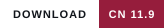</picture></a> | `ProgressIndicators_v1960_3264b_SB_CN11_5.ppam` |

1. Download and extract the English or Simplified Chinese ZIP. In desktop PowerPoint for Windows, open **File > Options > Add-ins**. Under **Manage**, select **PowerPoint Add-ins**. Click **Go**, choose **Add New**, and select the extracted `.ppam`. Enable one language edition at a time. The matching `.pptm` contains the editable VBA project. [All releases](https://github.com/GH-X-ST/PowerPoint-Progress-Indicators/releases)
2. Open the presentation. In the thumbnail pane, right-click where each section begins, choose **Add Section**, and enter its name. These names appear on the bar. Presentations without named sections can display slide markers. [Microsoft's guide to sections](https://support.microsoft.com/en-us/powerpoint/training/organize-your-powerpoint-slides-into-sections)
3. On the **Progress Indicators** tab, open **Design > Design Presets**. Under **Layers**, for example, open **Crimson Layers** and choose **Medium**. In the **Generate** group, select **Show All**, **Sections Only**, or **Icons Only**.
4. Choose **Slide Updates and Performance > Update Current Slide** to redraw the active slide. **Generate > Preview** updates up to three eligible slides, starting at the beginning of the selected range.
5. Click **Generate** to update the full range, then save the presentation. The navigation links work in Slide Show view. Generate again after adding, removing, or rearranging slides.

## Navigation layout

### Docking and spacing

Choose **Position and Visibility > Dock Edge** to place the bar at the top, bottom, left, or right. On either side, titles read horizontally and markers run vertically. Adjust **Sidebar Width (pt)** for longer names. **Design > Fill Dock Edge** extends the bar along the chosen edge. Use the **Layout** group to set margins and spacing.

<picture>
  <source media="(prefers-color-scheme: dark)" srcset="docs/assets/native/docking-dark.webp" />
  <source media="(prefers-color-scheme: light)" srcset="docs/assets/native/docking-light.webp" />
  
</picture>

The example presentation has five sections with 2, 3, 5, 2, and 2 slides. In the **Generate** group, **Equal Sections** gives each section one fifth of the bar. **Equal Slides** gives each counted slide the same space, so the five-slide Design section takes up 5/14 of the bar.

<picture>
  <source media="(prefers-color-scheme: dark)" srcset="docs/assets/native/spacing-dark.webp" />
  <source media="(prefers-color-scheme: light)" srcset="docs/assets/native/spacing-light.webp" />
  
</picture>

### Sizes and markers

Every preset offers **Small**, **Medium**, and **Large**. On the top or bottom edge, Small uses a 13 pt panel and 7 pt titles. Its markers are half as tall as in Large and span the middle 90% of each section. Sidebar width is set separately.

The Crimson Layers panels below measure 13, 21.45, and 44.2 pt. In 11.5, Medium and Large panels are 30% taller than in 11.4. The title side gains 20% of the original panel height and the marker side gains 10%. To use the new sizes in an existing presentation, reselect its preset and size, then click **Generate**.

<picture>
  <source media="(prefers-color-scheme: dark)" srcset="docs/assets/native/sizes-dark.webp" />
  <source media="(prefers-color-scheme: light)" srcset="docs/assets/native/sizes-light.webp" />
  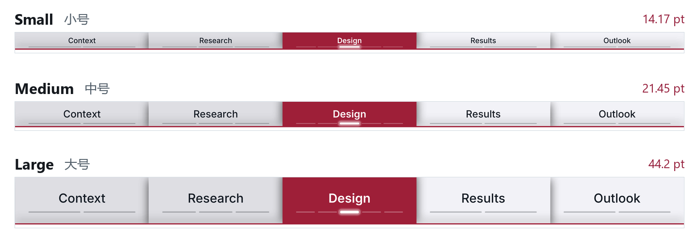
</picture>

In **Rounded Bars > Marker Shape**, choose **Short Rounded Bars**, **Square-Ended Segments**, **Ruler Ticks**, **Dots**, **Continuous Track and Cursor**, or **Square Cells**. The same group sets height, spacing, and current-slide glow. In dense sections, oval markers narrow along the bar while retaining their thickness.

<picture>
  <source media="(prefers-color-scheme: dark)" srcset="docs/assets/native/markers-dark.webp" />
  <source media="(prefers-color-scheme: light)" srcset="docs/assets/native/markers-light.webp" />
  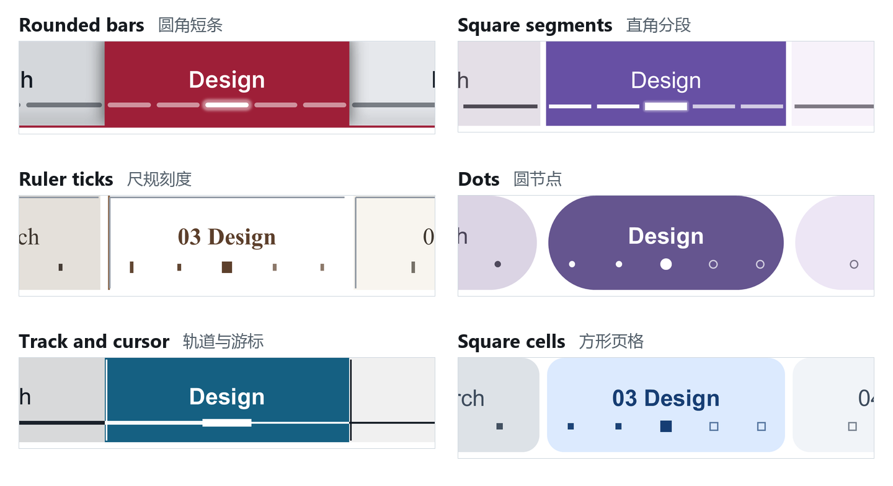
</picture>

Use **Progress Icons** to set colors and transparency for past, current, and upcoming slides. For traditional shapes or custom pictures, clear **Rounded Bars > Use Preset Slide Markers** and use **Progress Icons**. **Sections and Fonts** sets the section title font and size.

## Section design

### Titles, accents, and lines

Under **Text and Lines > Long Titles**, **Shrink Text to Fit** keeps the full name. **End with Ellipsis** truncates titles that exceed the available width. Both leave the PowerPoint section name intact.

<picture>
  <source media="(prefers-color-scheme: dark)" srcset="docs/assets/native/type-dark.webp" />
  <source media="(prefers-color-scheme: light)" srcset="docs/assets/native/type-light.webp" />
  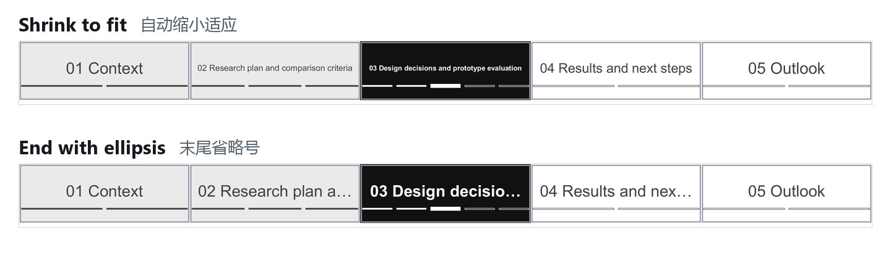
</picture>

| Feature | Ribbon control | Effect |
| --- | --- | --- |
| Title alignment and case | **Text and Lines > Title Alignment** and **Letter Case** | Aligns titles to **Center**, **Start**, or **End**. Keeps original case or displays titles in uppercase. |
| Numbering and emphasis | **Design > Number Sections** and **Bold Current Section Title** | Prefixes section names with numbers or emphasizes the current title. |
| Current section accent | **Design > Current Section Accent** | Marks the **Content Edge**, **Outer Edge**, or **Start Edge**, draws an **Inset Outline**, or removes the accent with **None**. The same group sets its color and weight. |
| Section boundaries | **Text and Lines > Section Lines** | Draws dividers, frames, or marks using the selected **Line Width (pt)** and **Line Color (RGB)**. |
| Marker color and fill | **Design > Outline Upcoming Bars** and **Match Bars to Section Text** | Draws hollow upcoming markers or uses the section text color for bars. |
| Contrast | **Section Panels > Auto Contrast for Text and Markers** | Chooses dark or white text and built-in markers for the panel background. |

<details>
<summary>Current section accents and section lines</summary>

On the top edge, **Content Edge** marks the bottom of the panel, next to the slide content. **Outer Edge** marks the top. **Start Edge** marks the beginning of the section.

<picture>
  <source media="(prefers-color-scheme: dark)" srcset="docs/assets/native/accents-dark.webp" />
  <source media="(prefers-color-scheme: light)" srcset="docs/assets/native/accents-light.webp" />
  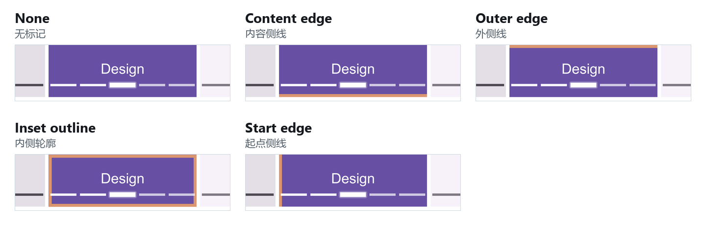
</picture>

The nine line settings include **Off**, **Double Rules**, and **Triple Dividers**. Triple Dividers draws three vertical lines at each section boundary in this example.

<picture>
  <source media="(prefers-color-scheme: dark)" srcset="docs/assets/native/section-lines-dark.webp" />
  <source media="(prefers-color-scheme: light)" srcset="docs/assets/native/section-lines-light.webp" />
  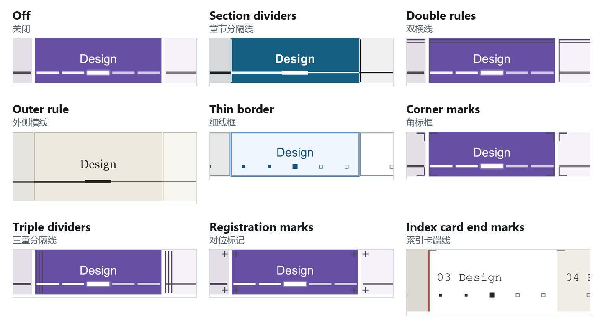
</picture>

</details>

<details>
<summary>Numbering, letter case, alignment, marker outlines, and contrast</summary>

Both examples in the bottom row use the same dark purple background. With **Auto Contrast for Text and Markers** on, the Design title and its markers change from muted purple to white.

<picture>
  <source media="(prefers-color-scheme: dark)" srcset="docs/assets/native/type-and-states-dark.webp" />
  <source media="(prefers-color-scheme: light)" srcset="docs/assets/native/type-and-states-light.webp" />
  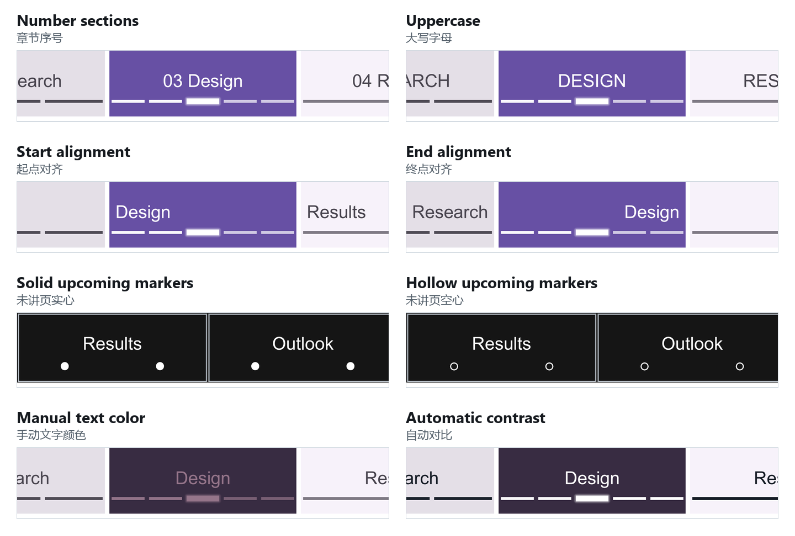
</picture>

</details>

### Color, shadows, and background text

**Section Panels** sets past, current, and upcoming panel transparency. Turn on **Two-Sided Gradient** to choose near and far colors independently for past and upcoming sections.

The middle row shows **Cropped Backdrop Text (Top) > Backdrop Text for Other Sections**. Research and Results each show a second, larger copy of their title, cropped at the panel edges. The current section, Design, keeps its solid red background. In the same group, set the text scale (110% to 300%), color, and transparency.

<picture>
  <source media="(prefers-color-scheme: dark)" srcset="docs/assets/native/surfaces-dark.webp" />
  <source media="(prefers-color-scheme: light)" srcset="docs/assets/native/surfaces-light.webp" />
  
</picture>

**Layered Navigation** controls the connecting strip and each panel's shadow, including blur, distance, and transparency. Crimson Layers joins the current chapter to a 1 pt strip. Panels closer to the current chapter sit in front of more distant ones. The current slide marker glows, and other markers use 70% transparency. For the preset's original lettering, install Inter Medium and Inter SemiBold on the computers used to prepare and present the slides. [Inter font family](https://rsms.me/inter/)

<details>
<summary>Per-slide theme colors</summary>

Turn on **Position and Visibility > Use Each Slide's Theme**. Universal Theme uses Accent 1 and the slide theme's light and dark colors. Picture and gradient backgrounds use theme colors. The figure shows the same preset with two theme palettes. Crimson Layers uses fixed colors by default.

<picture>
  <source media="(prefers-color-scheme: dark)" srcset="docs/assets/native/theme-dark.webp" />
  <source media="(prefers-color-scheme: light)" srcset="docs/assets/native/theme-light.webp" />
  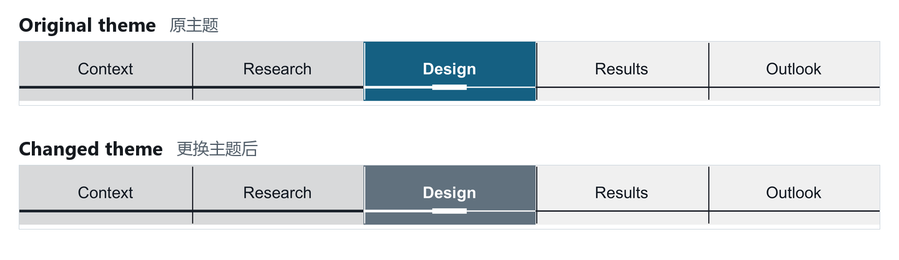
</picture>

</details>

## Counts and density

In **Counts and Density > Progress Count**, choose an overall count, a section count, a percentage, or both counts. For example, slide 8 of 14 is the third of five slides in Design. **Overall and Section Counts** displays both positions.

<picture>
  <source media="(prefers-color-scheme: dark)" srcset="docs/assets/native/counts-dark.webp" />
  <source media="(prefers-color-scheme: light)" srcset="docs/assets/native/counts-light.webp" />
  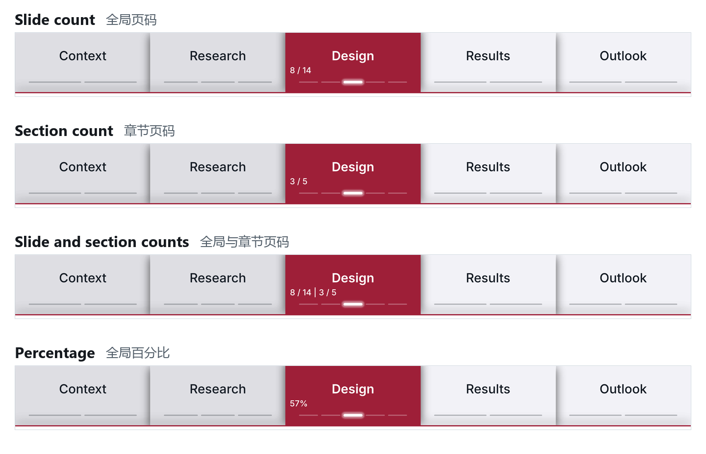
</picture>

**Marker Density** sets the number of individual markers displayed. All three modes count the same slides.

| Mode | Markers shown |
| --- | --- |
| **All Slides** | One per counted slide. |
| **Auto Density** | An inactive section collapses to one summary marker when its individual markers would be shorter than **Minimum Marker Length (pt)**. |
| **Focus on Current Section** | Individual markers in the current section and one summary marker for each other section. |

All three rows show the same slide in a 61-slide presentation. The third of the five markers under Design glows in every row. In the middle row, **Auto Density** replaces the tightly spaced marks under Context and Results with one long bar each.

<picture>
  <source media="(prefers-color-scheme: dark)" srcset="docs/assets/native/density-dark.webp" />
  <source media="(prefers-color-scheme: light)" srcset="docs/assets/native/density-light.webp" />
  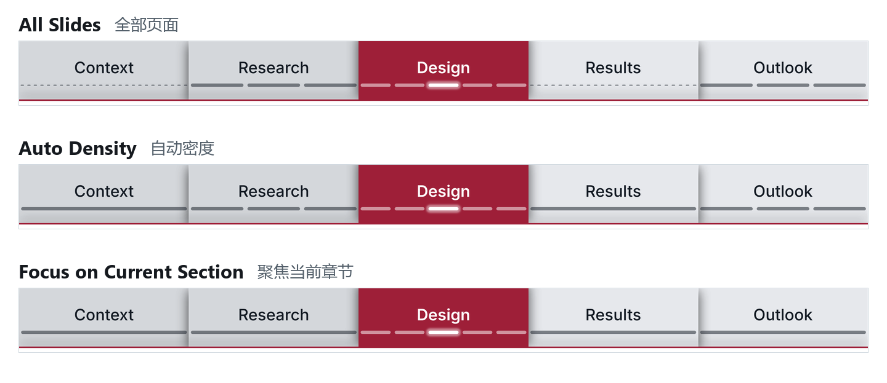
</picture>

## Updating slides

The first and last slide fields in **Generate** set the range for the current session. **Auto Update** redraws the bar as settings change. With it off, **Generate** applies several edits together.

In Normal view or Slide Sorter, select the slide thumbnails before applying a selection command.

| Feature | Ribbon control | Scope and effect |
| --- | --- | --- |
| Selective update | **Slide Updates and Performance > Update Selected Slides** | Redraws selected slides within the range. Counts cover the whole eligible presentation. |
| Removal | **Remove from Selected Slides** or **Generate > Remove** | Clears generated navigation from the selection or the entire range. Both retain the settings. |
| Visibility on a slide | **Hide on Selected Slides** or **Show on Selected Slides** | Hiding removes the bar immediately and saves that choice without changing the count. Showing restores navigation where the range and rules allow. |
| Skip or repeat | **Current Slide > Skip** or **Repeat**, with **Exclude > Skipped/Repeated** enabled | Skipped slides have no bar. Repeated slides show the preceding eligible position. Neither advances the count. **Normal** clears the mark. |
| PowerPoint's hidden slides | **Exclude > Hidden Slides** | Excludes hidden slides from progress. |

For a long presentation with **Show All** and individual markers, turn on **Slide Updates and Performance > Reuse Section Indicators**. Compatible slides in a section can share layout calculations and rendered shadow images while keeping their own titles, markers, and links. **Last Run Statistics** reports elapsed time, layout and shadow reuse, and PNG captures.

## Presentation settings and rules

- **Save a style in this presentation.** Open **Settings > My Presentation Presets > Save Current Settings as a Presentation Preset**. Enter a name. To reuse the settings, open the named preset, choose **Apply**, and generate the selected range. Each presentation can hold up to 32 named presets.
- **Copy settings to another presentation.** Under **Settings**, choose **Export** to save the current configuration as a `.txt` file. In the destination presentation, choose **Import**. Import applies the configuration and starts an update. Named presets and rules remain in the source presentation.
- **Show navigation on one master or layout.** Turn off multiple rules, then select a representative slide in Normal view. Open **Position and Visibility > Single Visibility Rule** and choose **Use Current Slide Master** or **Use Current Slide Layout**. The filter controls which slides display navigation. Counts still cover the same eligible slides. Save as `.pptx` or `.pptm` to keep the rule.
- **Give different layouts their own styles or visibility.** Configure a content slide, open **Position and Visibility > Master and Layout Rules > Save a Rule for the Current Slide**, and choose **Slide Master: Show with Current Style**. Select a cover slide and choose **Layout: Hide Indicators** from the same menu. Saving a rule enables multiple rules. Choose **Unmatched Slides: Show** or **Unmatched Slides: Hide**, then click **Generate**. A presentation can hold up to 32 rules.

**Hide on Selected Slides** takes priority. On other slides, the add-in checks for a matching layout rule, then a master rule, then applies the action for unmatched slides. All rules use the same count.

---

<a name="preset-gallery"></a>

## Gallery of all 40 presets

The gallery shows all 40 presets on the same slide. The headings follow the groups in **Design > Design Presets**.

<details>
<summary>General, Rounded and Segmented, Typography and Graphics</summary>

<picture>
  <source media="(prefers-color-scheme: dark)" srcset="docs/assets/gallery/presets-1-dark.webp" />
  <source media="(prefers-color-scheme: light)" srcset="docs/assets/gallery/presets-1-light.webp" />
  
</picture>

</details>

<details>
<summary>Layers, Minimal, Tonal, Soft Shadows and Outlines</summary>

<picture>
  <source media="(prefers-color-scheme: dark)" srcset="docs/assets/gallery/presets-2-dark.webp" />
  <source media="(prefers-color-scheme: light)" srcset="docs/assets/gallery/presets-2-light.webp" />
  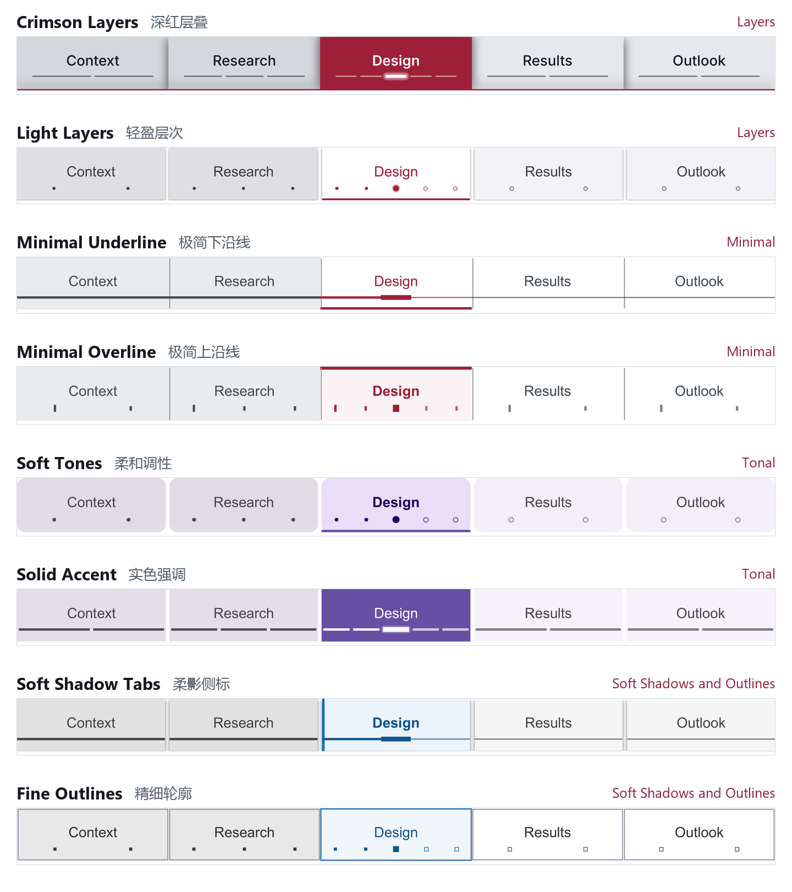
</picture>

</details>

<details>
<summary>Editorial, High Contrast, Translucent</summary>

<picture>
  <source media="(prefers-color-scheme: dark)" srcset="docs/assets/gallery/presets-3-dark.webp" />
  <source media="(prefers-color-scheme: light)" srcset="docs/assets/gallery/presets-3-light.webp" />
  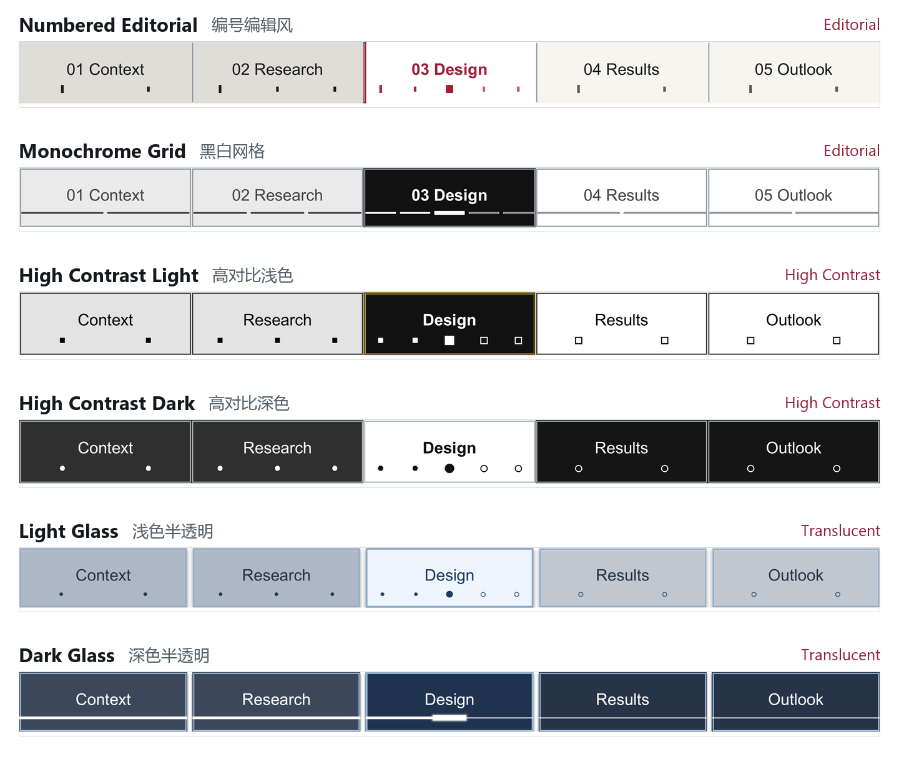
</picture>

</details>

<details>
<summary>Technical, Gradients, Materials and Hard Edges</summary>

<picture>
  <source media="(prefers-color-scheme: dark)" srcset="docs/assets/gallery/presets-4-dark.webp" />
  <source media="(prefers-color-scheme: light)" srcset="docs/assets/gallery/presets-4-light.webp" />
  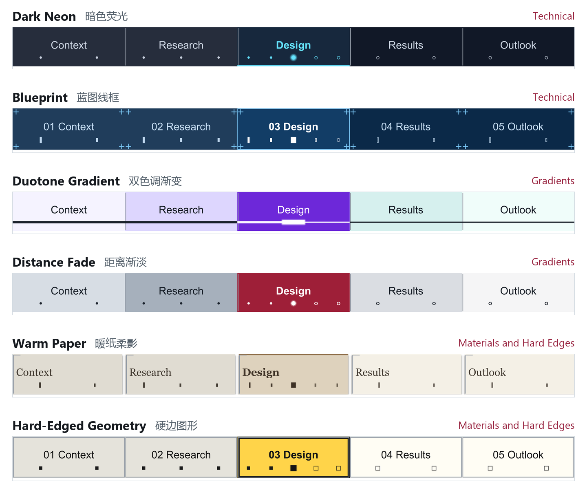
</picture>

</details>

<details>
<summary>Frames and Annotations, Editorial and Archival (Quiet Colophon and Type Specimen Index)</summary>

<picture>
  <source media="(prefers-color-scheme: dark)" srcset="docs/assets/gallery/presets-5-dark.webp" />
  <source media="(prefers-color-scheme: light)" srcset="docs/assets/gallery/presets-5-light.webp" />
  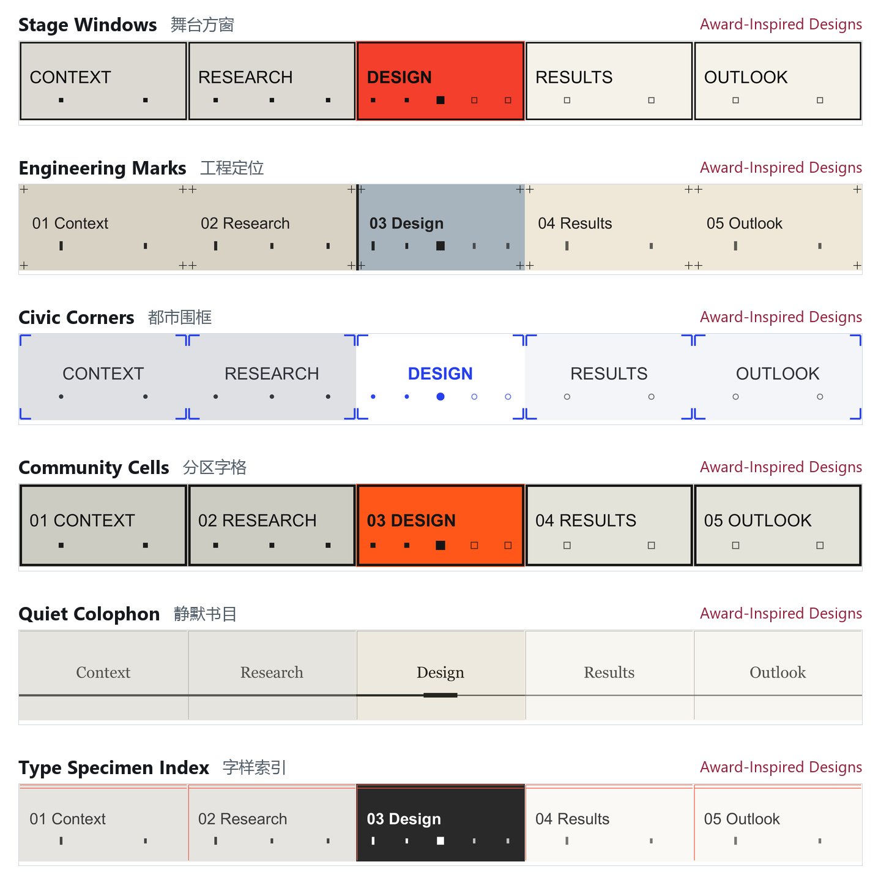
</picture>

</details>

<details>
<summary>Editorial and Archival (Botanical Labels and Archive Labels), Color Bands and Rhythm</summary>

<picture>
  <source media="(prefers-color-scheme: dark)" srcset="docs/assets/gallery/presets-6-dark.webp" />
  <source media="(prefers-color-scheme: light)" srcset="docs/assets/gallery/presets-6-light.webp" />
  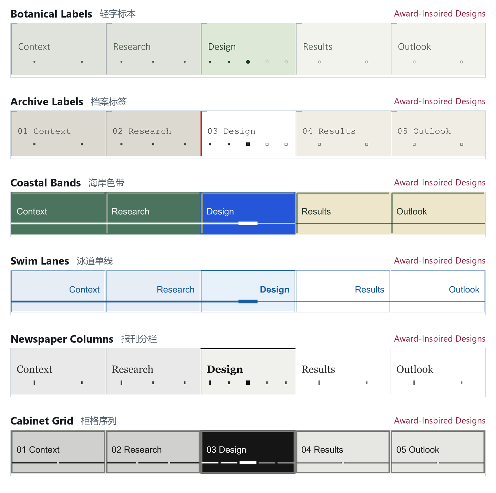
</picture>

</details>

<a name="upstream"></a>

## Changes from upstream 1.960

| Feature | Olaf Nöhring's Progress Indicator 1.960 | This edition adds |
| --- | --- | --- |
| Navigation and layout | Linked section titles and slide markers, two spacing modes, fonts, shapes, pictures, fills, and state colors | Four docking edges, adjustable sidebars, fill-to-edge layout, and 40 presets in three sizes |
| Panels and markers | Separate colors for past, current, and upcoming slides and sections, plus a theme color picker | Per-slide theme colors, dots and ticks, a continuous track and cursor, panel gradients, section lines, independent shadows, a connecting strip, marker glow, and cropped background text |
| Titles and counts | Font, size, title position, and the option to show sections, icons, or both | Long-title fitting and ellipsis, alignment and numbering, overall and section counts and percentages, automatic density, and current-section focus |
| Generation | Slide range, preview, automatic updates, removal, skip, repeat, and hidden-slide exclusion | Updates for the current slide or a selection, saved per-slide visibility, reuse of layouts and shadows, and run statistics |
| Settings | Settings saved in the presentation, plus configuration import and export | Named presets, master and layout rules for style and visibility, and separate English and Simplified Chinese releases |

The upstream project includes examples and documentation for the original add-in. [Project website](https://datenbank-projekt.de/projekte/progress-indicator-powerpoint-2010-2013-2016-32-and-64-bit-windows-mac) | [Bundled upstream README](original/ProgressIndicators_v1960_3264b/README.md)

<a name="build"></a>

## Build from source

The English build uses Python 3.12, the shared VBA and Ribbon XML in `source/`, the preset catalog in `styles.json`, translations in `locales/en/`, and upstream templates in `original/`. Run the following commands from the repository root in PowerShell.

```powershell
uv venv --python 3.12 .venv
uv pip install --python .venv\Scripts\python.exe -r requirements-build.txt
.\.venv\Scripts\python.exe build_package.py --language en --output-dir rebuild --report rebuild/package-validation.json
```

The build writes the maintenance presentation to `rebuild/`, the English VBA and Ribbon XML to `rebuild/en/source/`, and the English catalog to `rebuild/en/styles.json`. To create the release add-in, use the same PowerShell window. Desktop PowerPoint must be able to run macros in the maintenance presentation. The destination must be a new file.

```powershell
$name = 'ProgressIndicators_v1960_3264b_SB_EN11_5'
$sourceDeck = (Resolve-Path "rebuild\$name.pptm").Path
$releaseDir = Join-Path (Get-Location) 'rebuild\distribution'
$ppam = Join-Path $releaseDir "$name.ppam"
.\native\Publish-AddIn.ps1 -SourcePresentation $sourceDeck -Destination $ppam
Copy-Item -LiteralPath $sourceDeck -Destination (Join-Path $releaseDir "$name.pptm")
```

## License and credits

The software is distributed under the MIT License and retains the copyright notices of Edward Loper, Adam M. Wilson, and Olaf Nöhring. FatCow Farm-Fresh Web Icons in the upstream templates have separate attribution and licensing terms. [MIT License](LICENSE) | [Third-party notices](THIRD_PARTY_NOTICES.en.md)
