<p align="center"><a href="README.md"><picture><source media="(prefers-color-scheme: dark)" srcset="docs/assets/badges/lang-en-en-dark.svg" /><source media="(prefers-color-scheme: light)" srcset="docs/assets/badges/lang-en-en-light.svg" /></picture></a><!--
--><a href="README.zh-CN.md"><picture><source media="(prefers-color-scheme: dark)" srcset="docs/assets/badges/lang-en-zh-dark.svg" /><source media="(prefers-color-scheme: light)" srcset="docs/assets/badges/lang-en-zh-light.svg" /></picture></a></p>

<p align="center">
  <sub>This independent edition is based on <strong>Progress Indicator 1.960</strong>, released by Olaf Nöhring.</sub><br>
  <sub>Edward Loper wrote the original <em>Progress Dots</em> macro for PowerPoint, which Adam M. Wilson and Olaf Nöhring later extended.</sub><br>
  <sub><a href="https://github.com/AdamWilsonLab/progress_indicators">Upstream GitHub repository (AdamWilsonLab/progress_indicators)</a> | <a href="https://datenbank-projekt.de/projekte/progress-indicator-powerpoint-2010-2013-2016-32-and-64-bit-windows-mac">Olaf Nöhring's project page</a></sub>
</p>

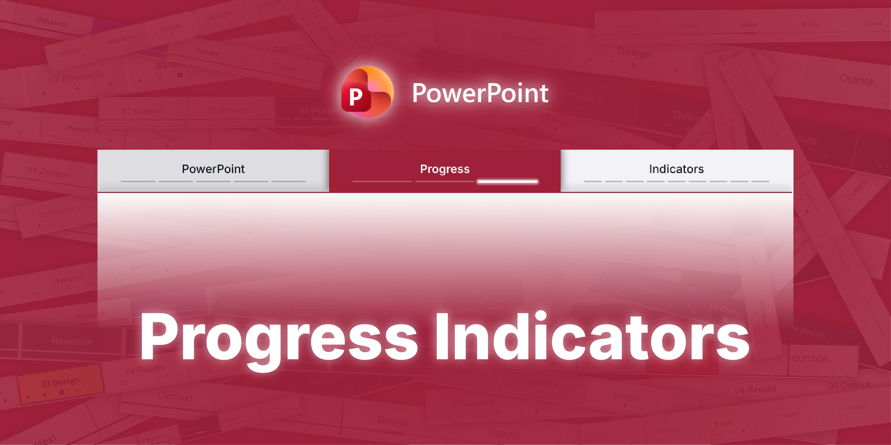

## About

Progress Indicators turns the section names in your PowerPoint presentation into a clickable navigation bar. During a slide show, the bar highlights the current section and your place within it. Click a section name to jump to that section, or click an individual slide marker to go straight to its slide.

The bar and its links are saved in the presentation. Anyone you send it to can use them in Slide Show view, even without the add-in. The English and Chinese editions include the same 40 presets.

<p align="center"><a href="#tutorial">Download and install</a> | <a href="#preset-gallery">Browse the 40 presets</a></p>

## Contents

- **Make a bar.** [First use](#tutorial) / [Position and size](#navigation-layout) / [Titles and colors](#section-design) / [Slide numbers and markers](#counts-and-density)
- **Work with a presentation.** [Update or hide a bar](#updating-slides) / [Save styles and layout rules](#presentation-settings-and-rules) / [Preset gallery](#preset-gallery)
- **Project details.** [Changes since 1.960](#upstream) / [Build from source](#build) / [License and credits](#license-and-credits)

---

<a name="tutorial"></a>
<a name="installation-and-first-use"></a>

## Install the add-in

Download the ZIP for the language you want on the PowerPoint ribbon. Both packages include a `.ppam` to install and a `.pptm` containing the editable VBA project. [All releases](https://github.com/GH-X-ST/PowerPoint-Progress-Indicators/releases)

| Download | File to open in PowerPoint |
| --- | --- |
| <a href="https://github.com/GH-X-ST/PowerPoint-Progress-Indicators/releases/download/EN.11.10/ProgressIndicators-EN.11.10.zip"><picture><source media="(prefers-color-scheme: dark)" srcset="docs/assets/badges/en-dark.svg" /><source media="(prefers-color-scheme: light)" srcset="docs/assets/badges/en-light.svg" /></picture></a> | `ProgressIndicators_v1960_3264b_SB_EN11_10.ppam` |
| <a href="https://github.com/GH-X-ST/PowerPoint-Progress-Indicators/releases/download/CN.11.10/ProgressIndicators-CN.11.10.zip"><picture><source media="(prefers-color-scheme: dark)" srcset="docs/assets/badges/cn-dark.svg" /><source media="(prefers-color-scheme: light)" srcset="docs/assets/badges/cn-light.svg" /></picture></a> | `ProgressIndicators_v1960_3264b_SB_CN11_10.ppam` |

1. Extract the ZIP. In PowerPoint for Windows, open **File > Options > Add-ins**.
2. At the bottom of the dialog, set **Manage** to **PowerPoint Add-ins** and click **Go**.
3. If another edition of Progress Indicators is enabled, clear its checkbox. Click **Add New** and select the `.ppam` you extracted. A **Progress Indicators** tab appears on the ribbon.

### Make your first bar

1. Open your presentation. If you haven't divided it into sections, right-click between two slide thumbnails, choose **Add Section**, and name the section. Repeat at each section break. For slide markers alone, you can leave the presentation unsectioned. [Organize slides into sections](https://support.microsoft.com/en-us/powerpoint/training/organize-your-powerpoint-slides-into-sections)
2. On the **Progress Indicators** tab, open **Design > Design Presets > Layers > Crimson Layers** and choose **Large** to match the example at the top of this page. Select **Show All** to display both section titles and slide markers. **Sections Only** and **Icons Only** let you keep just one.
3. Click **Preview**. PowerPoint draws the bar on up to three slides, starting with the first slide in the specified range where the bar should appear.
4. Click **Generate** to draw the bars throughout that range, then save the presentation. Start the slide show and click a section title. It opens the first slide in that section that counts toward progress.

<a name="navigation-layout"></a>

## Position and size

<a name="docking-and-spacing"></a>

### Choose an edge

Use **Position and Visibility > Dock Edge** to place the bar along any edge. A sidebar keeps the section names horizontal and stacks the markers vertically. If a name needs more room, increase **Sidebar Width (pt)**. To run the bar from corner to corner, turn on **Design > Fill Dock Edge**. For an inset bar, set the margins in **Layout**.

<picture>
  <source media="(prefers-color-scheme: dark)" srcset="docs/assets/native/docking-dark.webp" />
  <source media="(prefers-color-scheme: light)" srcset="docs/assets/native/docking-light.webp" />
  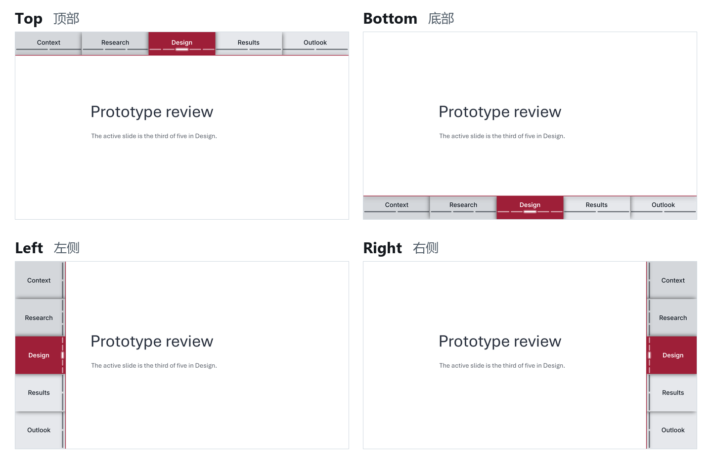
</picture>

With **Equal Sections**, each of the five sections below gets a fifth of the bar. With **Equal Slides**, a longer section gets more space. Design has five of the 14 slides, so it takes up 5/14 of the bar. Both options are in the **Generate** group.

<picture>
  <source media="(prefers-color-scheme: dark)" srcset="docs/assets/native/spacing-dark.webp" />
  <source media="(prefers-color-scheme: light)" srcset="docs/assets/native/spacing-light.webp" />
  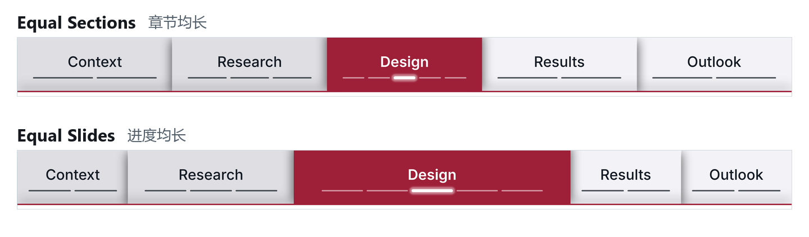
</picture>

<a name="sizes-and-markers"></a>

### Choose a size and marker shape

Each preset comes in **Small**, **Medium**, and **Large**. With a top or bottom bar, Small uses 7 pt titles. Its panel is 13 pt high in most presets and about 16.67 pt in Crimson Layers. In the Design example below, the title starts 7 pt below the top edge, and the bottom of the g sits 2 pt above the solid part of the current marker. The markers are half the height of the Large markers. They fill the middle 90% of the section in most presets. Crimson Layers uses the middle 80% at every size. For a left or right bar, adjust the sidebar width separately.

<picture>
  <source media="(prefers-color-scheme: dark)" srcset="docs/assets/native/sizes-dark.webp" />
  <source media="(prefers-color-scheme: light)" srcset="docs/assets/native/sizes-light.webp" />
  
</picture>

<details>
<summary>Panel heights in version 11.5</summary>

In Crimson Layers, the three heights are 13, 21.45, and 44.2 pt. Medium and Large are 30% taller than the corresponding sizes in 11.4. For every 10 pt of the previous height, the title side gained 2 pt and the marker side gained 1 pt. To use the new dimensions in an older presentation, choose the preset and size again, then click **Generate**.

</details>

Open **Rounded Bars > Marker Shape** to switch between bars, ticks, dots, a continuous track with a cursor, or square cells. Adjust marker height, spacing, and glow in the same group. In a crowded section, oval markers get narrower along the bar and keep their thickness.

<picture>
  <source media="(prefers-color-scheme: dark)" srcset="docs/assets/native/markers-dark.webp" />
  <source media="(prefers-color-scheme: light)" srcset="docs/assets/native/markers-light.webp" />
  
</picture>

For a PowerPoint shape or a picture of your own, clear **Rounded Bars > Use Preset Slide Markers**, then choose the shape or picture under **Progress Icons**. That group also has separate colors and transparency settings for slides you've passed, the current slide, and slides still to come.

<a name="section-design"></a>

## Section titles, markers, and colors

<a name="titles-accents-and-lines"></a>

### Fit the section names

Set the typeface and size under **Sections and Fonts**. If a name is too long, open **Text and Lines > Long Titles**. Choose **Shrink Text to Fit** to show the whole name, or **End with Ellipsis** to keep the lettering at its usual size and shorten the text on the bar. The section in PowerPoint keeps its original name.

<picture>
  <source media="(prefers-color-scheme: dark)" srcset="docs/assets/native/type-dark.webp" />
  <source media="(prefers-color-scheme: light)" srcset="docs/assets/native/type-light.webp" />
  
</picture>

<details>
<summary>Alignment, numbering, and marker colors</summary>

**Text and Lines** lets you align titles to the start, center, or end of each section and keep the original capitalization or use uppercase. Under **Design**, choose **Number Sections** to prefix each name with its number, or **Bold Current Section Title** to emphasize the section you're presenting.

In the same **Design** group, **Outline Upcoming Bars** gives the remaining slide markers a hollow center, and **Match Bars to Section Text** uses the title color for the markers. For a dark panel, try **Section Panels > Auto Contrast for Text and Markers**. In the bottom row below, switching it on changes the Design title and its markers from muted purple to white.

<picture>
  <source media="(prefers-color-scheme: dark)" srcset="docs/assets/native/type-and-states-dark.webp" />
  <source media="(prefers-color-scheme: light)" srcset="docs/assets/native/type-and-states-light.webp" />
  
</picture>

</details>

<details>
<summary>Mark the current section or draw lines between sections</summary>

Under **Design > Current Section Accent**, choose the edge to highlight. On a top bar, **Content Edge** draws a line along the bottom, next to the slide content. **Outer Edge** marks the top, and **Start Edge** marks the beginning of the section. **Inset Outline** draws a frame. Choose **None** to remove the accent, or change its color and weight in the same group.

<picture>
  <source media="(prefers-color-scheme: dark)" srcset="docs/assets/native/accents-dark.webp" />
  <source media="(prefers-color-scheme: light)" srcset="docs/assets/native/accents-light.webp" />
  
</picture>

To mark the boundary between *every* pair of sections, use **Text and Lines > Section Lines**. There are eight styles, plus **Off**. **Double Rules** draws a pair of lines and **Triple Dividers** draws three. Set their color and width in the same group.

<picture>
  <source media="(prefers-color-scheme: dark)" srcset="docs/assets/native/section-lines-dark.webp" />
  <source media="(prefers-color-scheme: light)" srcset="docs/assets/native/section-lines-light.webp" />
  
</picture>

</details>

<a name="color-shadows-and-background-text"></a>

### Color and shadows

In **Section Panels**, set different transparencies for the current section, the sections you've covered, and those still to come. Enable **Two-Sided Gradient** to give the earlier and later sections different colors and let each fade toward the end of the bar.

On a top bar, **Cropped Backdrop Text (Top) > Backdrop Text for Other Sections** repeats each inactive section's name behind its title. In the middle row, the large letters in Research and Results stop at the edge of their panels. Design keeps its solid red background. You can choose the background lettering's color, transparency, and scale (110% to 300%).

<picture>
  <source media="(prefers-color-scheme: dark)" srcset="docs/assets/native/surfaces-dark.webp" />
  <source media="(prefers-color-scheme: light)" srcset="docs/assets/native/surfaces-light.webp" />
  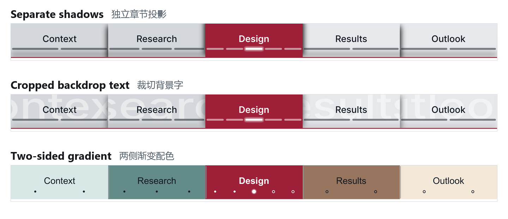
</picture>

**Crimson Layers** joins the current section to a 1 pt strip. Where two sections meet, the one closer to the current section casts its shadow on the other. The current slide has a thicker marker with a glow. Every other slide marker is thin and 85% transparent, including the others in the current section. Earlier and later sections use the same gray backgrounds as **Light Layers**. To adjust the strip or soften the shadows, open **Layered Navigation**. To match the lettering in the screenshot, install Inter SemiBold for the current section and Inter Medium for the others on the computers used to edit and present the slides. [Inter fonts](https://rsms.me/inter/)

<details>
<summary>Use colors from the presentation theme</summary>

Turn on **Position and Visibility > Use Each Slide's Theme** if the bar should change color with the slide master. The add-in uses Accent 1 for the current section and the theme's light and dark colors for the other panels. A solid slide background also helps determine whether the panels will be light or dark. On a picture or gradient background, the colors come from the theme. The two examples use Universal Theme. Crimson Layers has a fixed palette by default.

<picture>
  <source media="(prefers-color-scheme: dark)" srcset="docs/assets/native/theme-dark.webp" />
  <source media="(prefers-color-scheme: light)" srcset="docs/assets/native/theme-light.webp" />
  
</picture>

</details>

<a name="counts-and-density"></a>

## Slide numbers and long sections

Slide 8 of a 14-slide talk can also be slide 3 of 5 in Design. To show both positions, choose **Counts and Density > Progress Count > Overall and Section Counts**. You can also show just the overall count, just the section count, or either as a percentage. Hidden, skipped, and repeated slides count according to your settings.

<picture>
  <source media="(prefers-color-scheme: dark)" srcset="docs/assets/native/counts-dark.webp" />
  <source media="(prefers-color-scheme: light)" srcset="docs/assets/native/counts-light.webp" />
  
</picture>

If the marks in a long section become hard to tell apart, change **Counts and Density > Marker Density**. In the 61-slide example, Context and Results have many more slides than Design.

| Setting | What appears on the bar |
| --- | --- |
| **All Slides** | Each slide that counts has its own marker. |
| **Auto Density** | Context and Results each become one bar when their individual markers would be shorter than **Minimum Marker Length (pt)**. The current section keeps all its markers. |
| **Focus on Current Section** | Only Design shows individual slides. Every other section has one bar, regardless of length. |

The third marker in Design glows in all three rows. Changing the density changes how much detail you see. The slide number stays the same.

<picture>
  <source media="(prefers-color-scheme: dark)" srcset="docs/assets/native/density-dark.webp" />
  <source media="(prefers-color-scheme: light)" srcset="docs/assets/native/density-light.webp" />
  
</picture>

<a name="updating-slides"></a>

## Update or hide the bar

After adding, removing, or rearranging slides, click **Generate** to update the positions and links. The first and last slide fields in the **Generate** group set the range for this session. Turn off **Auto Update** to make several design changes before redrawing the bars.

For a single slide, choose **Slide Updates and Performance > Update Current Slide**. For several slides, select their thumbnails in Normal view or Slide Sorter and choose **Update Selected Slides**. Suppose all 14 slides in your presentation count toward progress. If you set the range to slides 5 through 10 and select slides 4 and 8, only slide 8 gets a new bar. Its overall count is still 8/14.

| What you want to do | Command |
| --- | --- |
| Remove a bar you plan to generate again | **Remove from Selected Slides** clears bars on the selected slides within the range. **Generate > Remove** clears every bar in the range. Both keep your settings. |
| Leave the cover slide without a bar | Select the cover and choose **Hide on Selected Slides**. The cover still counts, and the bar stays hidden the next time you generate. Choose **Show on Selected Slides** to let the bar appear there again if the slide's layout and master allow it. |
| Leave a slide out of the count | Turn on **Exclude > Skipped/Repeated**, then choose **Current Slide > Skip** to remove its bar or **Repeat** to show the previous counted slide's progress. Neither advances the count. **Normal** clears the setting. |
| Exclude slides hidden in PowerPoint | Turn on **Exclude > Hidden Slides**. |

If a long presentation takes time to update, turn on **Slide Updates and Performance > Reuse Section Indicators**. With **Show All** and **All Slides** selected, the add-in can reuse the bar and shadows across slides that share a section, design settings, theme, layout, and background. Each slide still gets its own highlight and links. Open **Last Run Statistics** to see how long the update took, how many slides shared a layout, and how many shadow images were captured or reused.

<a name="presentation-settings-and-rules"></a>

## Save a style or apply it by slide layout

### Use the same style again

When the bar looks right, choose **Settings > My Presentation Presets > Save Current Settings as a Presentation Preset** and enter a name. To use it later, open the named preset, click **Apply**, and generate the bars. Each presentation can store up to 32 presets.

To take the current settings to another presentation, choose **Settings > Export** and save the `.txt` file. Open the other presentation and choose **Import**. PowerPoint applies the settings and updates the bars. Your list of saved presets and your layout rules stay with the original presentation.

### Put the bar on content slides and leave it off the cover

For one master or layout, turn off multiple rules. In Normal view, select a slide that uses the master or layout you want. Under **Position and Visibility > Single Visibility Rule**, choose **Use Current Slide Master** or **Use Current Slide Layout**. Only slides that share it will show the bar. Save the presentation as `.pptx` or `.pptm` to keep the rule.

If the cover and the content slides share a master, give the cover its own rule.

1. Set up the bar on a content slide. Under **Position and Visibility > Master and Layout Rules > Save a Rule for the Current Slide**, choose **Slide Master: Show with Current Style**.
2. Select the cover slide. From the same menu, choose **Layout: Hide Indicators**.
3. Saving a rule enables multiple rules. Set **Unmatched Slides** to show or hide the bar on the remaining slides, then click **Generate**.

The cover stays clear because its layout rule takes priority over its master. Hiding the bar manually on an individual slide takes priority over both. These rules change where the bar appears and how it looks. Slides still count the same way throughout the presentation. You can save up to 32 rules in one file.

<a name="preset-gallery"></a>
<a name="gallery-of-all-40-presets"></a>

## Preset gallery

These are all 40 presets on the same PowerPoint slide. In every example, Design is the current section and its third slide is on screen. The presets appear in the same order under **Design > Design Presets**.

### General

#### Universal Theme


### Rounded and Segmented

#### Expressive Pills


#### Bento Segments


#### Translucent Pills


#### Soft Minimal

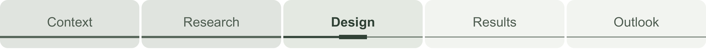

### Typography and Graphics

#### Hard Offset


#### Retro Terminal


#### Serif Editorial

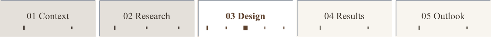

### Layers

#### Crimson Layers


#### Light Layers


### Minimal

#### Minimal Underline


#### Minimal Overline


### Tonal

#### Soft Tones


#### Solid Accent


### Soft Shadows and Outlines

#### Soft Shadow Tabs


#### Fine Outlines


### Editorial

#### Numbered Editorial


#### Monochrome Grid


### High Contrast

#### High Contrast Light


#### High Contrast Dark


### Translucent

#### Light Glass

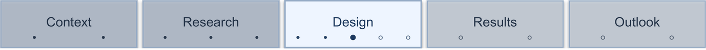

#### Dark Glass

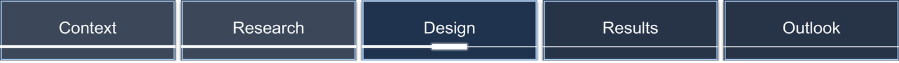

### Technical

#### Dark Neon

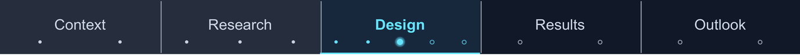

#### Blueprint


### Gradients

#### Duotone Gradient


#### Distance Fade


### Materials and Hard Edges

#### Warm Paper


#### Hard-Edged Geometry


### Frames and Annotations

#### Stage Windows


#### Engineering Marks


#### Civic Corners

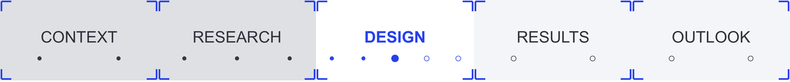

#### Community Cells


### Editorial and Archival

#### Quiet Colophon

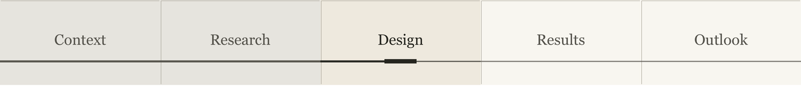

#### Type Specimen Index

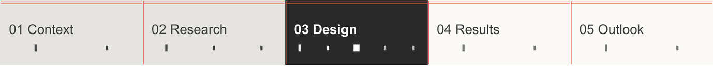

#### Botanical Labels

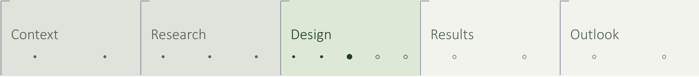

#### Archive Labels

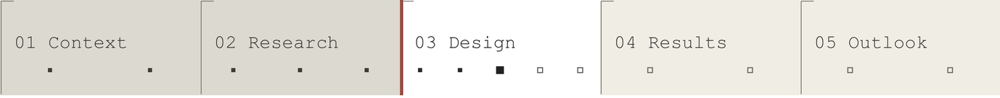

### Color Bands and Rhythm

#### Coastal Bands


#### Swim Lanes


#### Newspaper Columns


#### Cabinet Grid

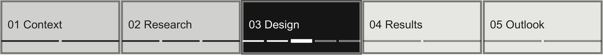

<a name="upstream"></a>
<a name="changes-from-upstream-1960"></a>

## Changes since Progress Indicator 1.960

Version 1.960 already included clickable titles and markers, the two spacing options, and custom fonts, shapes, pictures, and colors for past, current, and upcoming slides. It could already generate a preview, update a range of slides, skip or repeat a slide, exclude hidden slides, and save or export settings. [Original project](https://datenbank-projekt.de/projekte/progress-indicator-powerpoint-2010-2013-2016-32-and-64-bit-windows-mac) | [Original README](original/ProgressIndicators_v1960_3264b/README.md)

| This edition adds | Where to find it |
| --- | --- |
| 40 presets in three sizes, four slide edges, adjustable sidebars, and six marker shapes | [Position and size](#navigation-layout) |
| Per-slide theme colors, gradients, section dividers, shadows, a connecting strip, marker glow, background lettering, and more control over long titles | [Section titles, markers, and colors](#section-design) |
| Slide and section counts, percentages, and fewer markers in long sections | [Slide numbers and long sections](#counts-and-density) |
| Updates for individual slides or a selection, per-slide visibility, layout and shadow reuse, and generation statistics | [Update or hide the bar](#updating-slides) |
| Named presets and rules for masters and layouts | [Saved styles and layout rules](#presentation-settings-and-rules) |

<a name="build"></a>

## Build from source

The two language editions share the VBA and Ribbon XML in `source/`. The English build also reads the preset catalog (`styles.json`), the English strings in `locales/en/`, and the PowerPoint templates in `original/`.

From the repository root, run these commands in PowerShell to build the editable English presentation with Python 3.12.

```powershell
uv venv --python 3.12 .venv
uv pip install --python .venv\Scripts\python.exe -r requirements-build.txt
.\.venv\Scripts\python.exe build_package.py --language en --output-dir rebuild --report rebuild/package-validation.json
```

The build creates `rebuild/ProgressIndicators_v1960_3264b_SB_EN11_10.pptm`. The English VBA and Ribbon XML are in `rebuild/en/source/` and the translated preset catalog is in `rebuild/en/styles.json`.

To package the `.ppam`, continue in the same PowerShell window. This step uses desktop PowerPoint and needs permission to run the presentation's macros. Choose a new output file.

```powershell
$name = 'ProgressIndicators_v1960_3264b_SB_EN11_10'
$sourceDeck = (Resolve-Path "rebuild\$name.pptm").Path
$releaseDir = Join-Path (Get-Location) 'rebuild\distribution'
$ppam = Join-Path $releaseDir "$name.ppam"
.\native\Publish-AddIn.ps1 -SourcePresentation $sourceDeck -Destination $ppam
Copy-Item -LiteralPath $sourceDeck -Destination (Join-Path $releaseDir "$name.pptm")
```

## License and credits

Progress Indicators uses the MIT License. The original copyright notices credit Edward Loper, Adam M. Wilson, and Olaf Nöhring. The FatCow Farm-Fresh Web Icons in the PowerPoint templates have their own license and attribution terms. [MIT License](LICENSE) | [Third-party notices](THIRD_PARTY_NOTICES.en.md)
