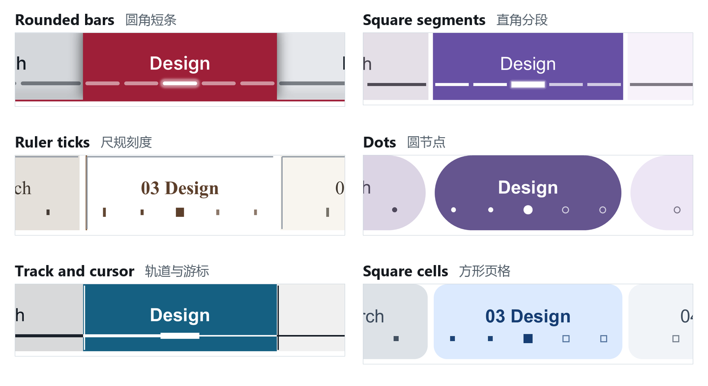
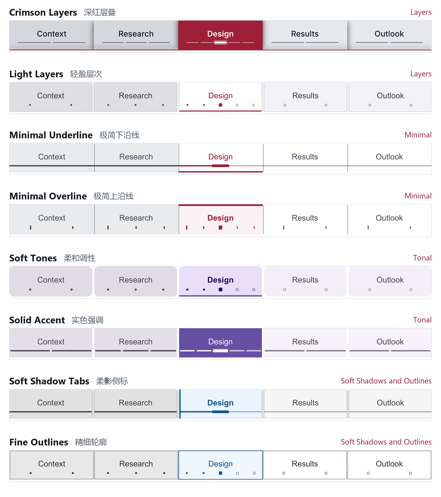
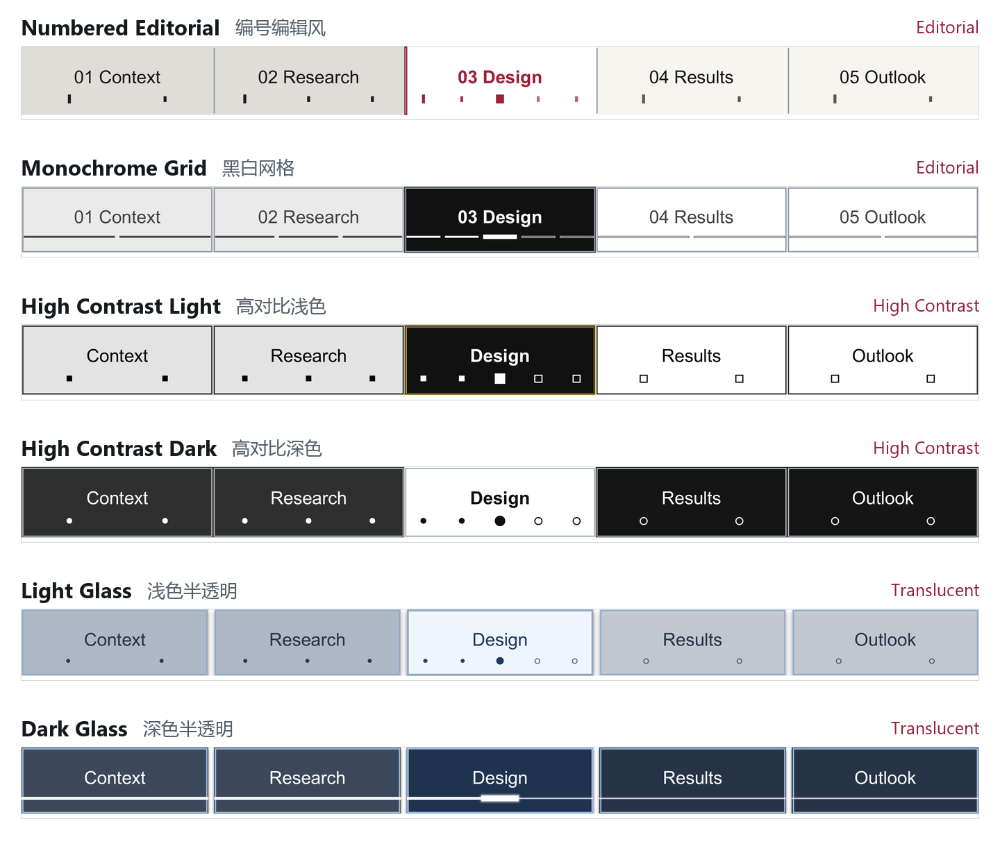

<p align="center"><a href="README.md"><picture><source media="(prefers-color-scheme: dark)" srcset="docs/assets/badges/lang-zh-en-dark.svg" /><source media="(prefers-color-scheme: light)" srcset="docs/assets/badges/lang-zh-en-light.svg" /></picture></a><!--
--><a href="README.zh-CN.md"><picture><source media="(prefers-color-scheme: dark)" srcset="docs/assets/badges/lang-zh-zh-dark.svg" /><source media="(prefers-color-scheme: light)" srcset="docs/assets/badges/lang-zh-zh-light.svg" /></picture></a></p>

<h1 align="center">PowerPoint 演讲进度条</h1>

<p align="center"><sub>Windows 桌面版 PowerPoint &nbsp;|&nbsp; EN.11.5 / CN.11.5</sub></p>


## 关于

PowerPoint 演讲进度条是一个 VBA 加载项，基于 Olaf Nöhring 的 Progress Indicator 1.960 独立维护。它按演示文稿的节名和页序生成导航。放映时，点击章节名可跳到该章第一张计入进度的幻灯片，点击页标可跳到对应页。本页的幻灯片示例由 11.5 正式加载项在 Windows 桌面 PowerPoint 中生成。

## 目录

- [安装与首次生成](#tutorial)
- [导航布局](#layout)
- [章节样式](#section-design)
- [计数与密度](#counts)
- [局部更新与生成统计](#slide-updates)
- [文稿配置与显示规则](#presentation-settings)
- [40 款预设图册](#preset-gallery)
- [与原版 1.960 的功能对照](#upstream)
- [从源码构建](#build)
- [许可证与署名](#license)

---

<a id="tutorial"></a>

## 安装与首次生成

### 下载与安装

| 发行包 | PowerPoint 加载项 |
| --- | --- |
| <a href="https://github.com/GH-X-ST/PowerPoint-Progress-Indicators/releases/download/CN.11.5/ProgressIndicators-CN.11.5.zip"><picture><source media="(prefers-color-scheme: dark)" srcset="docs/assets/badges/cn-dark.svg" /><source media="(prefers-color-scheme: light)" srcset="docs/assets/badges/cn-light.svg" /></picture></a> | `ProgressIndicators_v1960_3264b_SB_CN11_5.ppam` |
| <a href="https://github.com/GH-X-ST/PowerPoint-Progress-Indicators/releases/download/EN.11.5/ProgressIndicators-EN.11.5.zip"><picture><source media="(prefers-color-scheme: dark)" srcset="docs/assets/badges/en-dark.svg" /><source media="(prefers-color-scheme: light)" srcset="docs/assets/badges/en-light.svg" /></picture></a> | `ProgressIndicators_v1960_3264b_SB_EN11_5.ppam` |

1. 解压所需语言的发行包。`.ppam` 是加载项，同包的 `.pptm` 用于在 PowerPoint 中查看或修改 VBA 工程。[全部发行版本](https://github.com/GH-X-ST/PowerPoint-Progress-Indicators/releases)
2. 在 Windows 桌面 PowerPoint 中，打开 **文件 > 选项 > 加载项**。在 **管理** 中选择 **PowerPoint 加载项**，点击 **转到**。
3. 取消勾选已启用的旧版或另一语言版本。点击 **添加**，选中解压后的 `.ppam`，按本机的宏授权流程启用。中文版的功能区选项卡名为 **演讲进度条**。

### 生成与放映

1. 在缩略图窗格中，右键点击新章起点处的幻灯片间隙，选择 **新增节** 并命名。节名用于导航标题。未分节的文稿也可显示逐页标记。[Microsoft 的分节说明](https://support.microsoft.com/zh-cn/powerpoint/training/organize-your-powerpoint-slides-into-sections)
2. 打开 **演讲进度条 > 设计样式 > 样式预设**，展开样式并选择 **大号**、**中号** 或 **小号**。例如，“层次”分组中包含 **深红层叠**。
3. 在 **位置与显示 > 停靠边** 选择页面边缘，为原有标题、校徽或页脚留出空间。在 **生成** 组选择均长方式。**完整显示** 同时显示章名和页标，也可选择 **仅章节** 或 **仅图标**。
4. 点击 **局部更新与性能 > 更新当前页** 查看当前页的效果。**生成 > 预览** 会更新起止页码范围内最先符合显示条件的最多三页。
5. 确认样式后，点击 **生成** 组中的 **生成**，保存文稿。在幻灯片放映中点击章名和页标即可跳转。增删、重排幻灯片或调整分节后，再次生成以更新进度和链接。

---

<a id="layout"></a>

## 导航布局

### 停靠与长度分配

**位置与显示 > 停靠边** 提供顶部、底部、左侧和右侧。左右停靠时，章名保持横排，页标沿侧边纵向排列。**侧栏宽度 (pt)** 设置左右侧栏宽度，**设计样式 > 铺满当前边** 将导航的起止位置延伸至该边两端。

<picture>
  <source media="(prefers-color-scheme: dark)" srcset="docs/assets/native/docking-dark.webp" />
  <source media="(prefers-color-scheme: light)" srcset="docs/assets/native/docking-light.webp" />
  
</picture>

<details>
<summary>章节均长与进度均长</summary>

下图的五个章节分别有 2、3、5、2、2 页。选择 **章节均长** 时，各章分得相同长度。选择 **进度均长** 时，按计入进度的页数分配长度，5 页的 Design 章占可分配长度的 5/14。

<picture>
  <source media="(prefers-color-scheme: dark)" srcset="docs/assets/native/spacing-dark.webp" />
  <source media="(prefers-color-scheme: light)" srcset="docs/assets/native/spacing-light.webp" />
  
</picture>

</details>

### 章体尺寸

上下停靠时，深红层叠的小、中、大号章体高度依次为 **13、21.45、44.2 pt**。所有小号预设均使用 13 pt 章体、7 pt 章名，页标厚度为同款大号的一半。每章首个页标的起始外缘至末个页标的结束外缘，占章宽的 90%。

11.5 的中、大号章体比各款在 11.4 中的同档实际高度增加 30%。原章高每 10 pt，章名一侧增加 2 pt，页标一侧增加 1 pt。原字号、页标厚度和两者间距沿用各自预设。启用连接条时，三档默认厚度均为 1 pt。旧文稿要采用新版比例，需重新选择预设和尺寸，再生成导航。

<picture>
  <source media="(prefers-color-scheme: dark)" srcset="docs/assets/native/sizes-dark.webp" />
  <source media="(prefers-color-scheme: light)" srcset="docs/assets/native/sizes-light.webp" />
  
</picture>

### 页标

**圆角横条 > 标记形状** 提供六种预设页标，可在同组调整高度、间距、圆角和当前页光晕。章节内页数增加时，椭圆页标沿章节排列方向伸缩，厚度保持不变。使用传统 PowerPoint 形状或自定义图片时，先取消 **圆角横条 > 使用预设页标记**，再到 **进度图标** 选择图标形状。

<picture>
  <source media="(prefers-color-scheme: dark)" srcset="docs/assets/native/markers-dark.webp" />
  <source media="(prefers-color-scheme: light)" srcset="docs/assets/native/markers-light.webp" />
  
</picture>

**深红层叠** 将当前章与连接条绘制成连续轮廓。越靠近当前章的章体越靠前。仅当前页标发光，其余页标透明度均为 70%。当前章名使用 Inter SemiBold，其他章名使用 Inter Medium。制作和放映设备安装这两种字重后即可按设计显示。[Inter 字体](https://rsms.me/inter/)

---

<a id="section-design"></a>

## 章节样式

| 设置位置 | 可调内容 |
| --- | --- |
| **章节与字体**、**文字与线条** | 章名字体、字号、对齐和字母形式。对于超出章宽的标题，**长标题** 可选择 **自动缩小适应** 或 **末尾省略号**。 |
| **进度图标**、**设计样式** | 已讲、当前、未讲页标的颜色与透明度。当前章标记的位置、粗细和颜色。可为章节添加序号、加粗当前章名、将未讲页标设为空心，或让页标跟随章节文字配色。 |
| **章节色块** | 各状态的章面颜色与透明度、两侧渐变，以及 **文字与进度自动对比**。 |
| **层叠导航** | 横向章高、章节独立投影、阴影柔化与距离，以及当前章连接条的长度和厚度。 |
| **裁切背景字（顶部）** | 在非当前章的色块内显示放大的章名，超出色块的部分裁切。该效果只用于顶部停靠，背景字的放大比例可设为 110% 至 300%。 |

<picture>
  <source media="(prefers-color-scheme: dark)" srcset="docs/assets/native/type-dark.webp" />
  <source media="(prefers-color-scheme: light)" srcset="docs/assets/native/type-light.webp" />
  
</picture>

下图第二行中，Research 和 Results 的标题背后各有一层放大的章名。字母只显示在各自的色块内，当前章 Design 仍是深红底。

<picture>
  <source media="(prefers-color-scheme: dark)" srcset="docs/assets/native/surfaces-dark.webp" />
  <source media="(prefers-color-scheme: light)" srcset="docs/assets/native/surfaces-light.webp" />
  
</picture>

<details>
<summary>当前章标记与章节分隔线</summary>

在 **设计样式 > 当前章标记** 中选择标记形式。顶部停靠时，**内容侧线** 位于章体下方，**外侧线** 位于上方，**起点侧线** 位于章节起点。其他停靠边按相同的边缘关系定位。

<picture>
  <source media="(prefers-color-scheme: dark)" srcset="docs/assets/native/accents-dark.webp" />
  <source media="(prefers-color-scheme: light)" srcset="docs/assets/native/accents-light.webp" />
  
</picture>

**文字与线条 > 平面线条** 提供章节分隔线、框线、对位标记等八种样式，也可关闭。线宽和线色在同组设置。

<picture>
  <source media="(prefers-color-scheme: dark)" srcset="docs/assets/native/section-lines-dark.webp" />
  <source media="(prefers-color-scheme: light)" srcset="docs/assets/native/section-lines-light.webp" />
  
</picture>

</details>

<details>
<summary>编号、对齐与状态色</summary>

最下排的两块深紫色背景相同。打开 **文字与进度自动对比** 后，Design 的章名和页标从灰紫色变成白色。

<picture>
  <source media="(prefers-color-scheme: dark)" srcset="docs/assets/native/type-and-states-dark.webp" />
  <source media="(prefers-color-scheme: light)" srcset="docs/assets/native/type-and-states-light.webp" />
  
</picture>

</details>

<details>
<summary>按幻灯片主题配色</summary>

启用 **位置与显示 > 跟随当前页主题** 后，加载项按目标页主题的强调色 1 和明暗色生成配色。纯色背景参与章面明暗选择，图片或渐变背景采用主题色。下图以通用主题预设对照两种幻灯片主题。深红层叠默认使用固定配色。

<picture>
  <source media="(prefers-color-scheme: dark)" srcset="docs/assets/native/theme-dark.webp" />
  <source media="(prefers-color-scheme: light)" srcset="docs/assets/native/theme-light.webp" />
  
</picture>

</details>

---

<a id="counts"></a>

## 计数与密度

**页码与密度 > 进度计数** 可显示全局或章内的页数、百分比，也可同时显示两种页数。计数依据整份文稿中计入进度的页面，使用当前的隐藏页、跳过页和沿用页设置。

**进度密度** 控制同一进度的显示方式。**全部页面** 保留逐页标记。**自动密度** 在非当前章的单个页标短于 **最短页条 (pt)** 时，将该章合为一条。**聚焦当前章节** 仅为当前章保留逐页标记，其他章节各显示一条汇总标记。

这份文稿有 61 页。三行图都停在 Design 章的第 3 页，五个页标中第三个发亮。中间一行启用了 **自动密度**，Context 和 Results 原本密集的短线各合成了一条长线。

<picture>
  <source media="(prefers-color-scheme: dark)" srcset="docs/assets/native/density-dark.webp" />
  <source media="(prefers-color-scheme: light)" srcset="docs/assets/native/density-light.webp" />
  
</picture>

<details>
<summary>全局与章内计数示例</summary>

下图取自另一份 14 页文稿。当前页是全稿第 8 页、Design 章第 3 页，该章共 5 页。

<picture>
  <source media="(prefers-color-scheme: dark)" srcset="docs/assets/native/counts-dark.webp" />
  <source media="(prefers-color-scheme: light)" srcset="docs/assets/native/counts-light.webp" />
  
</picture>

</details>

---

<a id="slide-updates"></a>

## 局部更新与生成统计

**生成** 组中的起始和结束页码限定本次生成或移除的范围。该范围不会随文稿保存。批量调整样式时，可关闭 **自动更新**，完成后统一生成。

| 操作 | 作用范围与结果 |
| --- | --- |
| **更新当前页 / 更新所选页** | 在 **局部更新与性能** 组执行。多选时可使用缩略图窗格或幻灯片浏览视图。仅更新所选页与指定页码范围的交集，仍按整份文稿计算进度。 |
| **移除所选页导航** | 删除所选页与指定页码范围交集中的导航图形。**生成 > 移除** 则删除指定范围内所有页面的导航。两者均保留配置，可再次生成。 |
| **所选页不显示导航 / 恢复所选页显示** | 前者立即移除所选页的导航并保存逐页隐藏状态，适用于需要计数但不显示导航的封面。后者清除该状态，再按页码范围和显示规则生成。 |
| **当前页 > 跳过 / 沿用 / 正常** | 勾选 **排除 > 跳过/沿用** 时，跳过页不显示导航，沿用页显示上一张计入进度页面的状态，两者均不推进计数。**正常** 清除这两种标记。勾选 **排除 > 隐藏页** 可排除 PowerPoint 中已隐藏的幻灯片。 |

**局部更新与性能 > 复用同章导航** 可在一次生成中复用同章页面的布局和阴影图。复用要求显示完整的章面和全部页标，页面的配置、主题、版式与背景相符。页标状态及跳转目标仍按页生成。**上次生成统计** 可查看上次生成的耗时、布局复用次数、阴影图复用次数和 PNG 捕获次数。

---

<a id="presentation-settings"></a>

## 文稿配置与显示规则

### 保存和转移配置

- **保存为文稿预设**　选择 **配置 > 我的文档预设 > 保存当前配置为文档预设** 并命名。调用时展开该预设，选择 **应用**，再生成相应页面。每份文稿最多可保存 32 个命名预设。
- **跨文稿使用**　在 Windows 中选择 **配置 > 导出**，保存 `.txt` 文件。在目标文稿中选择 **配置 > 导入** 后，加载项会应用该配置并启动更新。文本文件包含当前这一套配置，命名预设和规则清单保存在各自的文稿中。

### 按母版或版式显示

**单一绑定**　先关闭多规则，再在普通视图中选择具有目标母版或版式的幻灯片，打开 **位置与显示 > 单一显示绑定**，选择绑定当前页的母版或版式。导航生成在符合条件的幻灯片上，各页仍按相同规则计数。可使用 `.pptx` 或 `.pptm` 保存绑定。

**多规则示例**

以下设置为正文母版指定导航样式，并在封面版式上隐藏导航。

1. 在正文页设好样式，选择 **位置与显示 > 多母版与版式规则 > 为当前页面保存规则 > 母版：显示并使用当前样式**。
2. 切换到使用封面版式的幻灯片，在同一菜单选择 **版式：隐藏进度条**。
3. 保存规则后，多规则自动启用。设置 **未匹配页面** 的显示动作，再点击 **生成**。

加载项依次检查逐页手动隐藏、精确版式和母版规则。其余页面按未匹配页面的默认动作处理。每份文稿最多可保存 32 条规则。规则控制显示和样式，进度仍按整份文稿统一计算。

---

<a id="preset-gallery"></a>

## 40 款预设图册

以下六组图按 **设计样式 > 样式预设** 的菜单顺序排列。各款使用同一份文稿，便于对照章节布局和页标形状。深色、浅色页面均保留幻灯片本身的配色。

<details>
<summary>通用、圆角与分段、排版与图形（8 款）</summary>

<picture>
  <source media="(prefers-color-scheme: dark)" srcset="docs/assets/gallery/presets-1-dark.webp" />
  <source media="(prefers-color-scheme: light)" srcset="docs/assets/gallery/presets-1-light.webp" />
  
</picture>

</details>

<details>
<summary>层次、极简、调性、柔影与轮廓（8 款）</summary>

<picture>
  <source media="(prefers-color-scheme: dark)" srcset="docs/assets/gallery/presets-2-dark.webp" />
  <source media="(prefers-color-scheme: light)" srcset="docs/assets/gallery/presets-2-light.webp" />
  
</picture>

</details>

<details>
<summary>编辑排版、高对比、半透明材质（6 款）</summary>

<picture>
  <source media="(prefers-color-scheme: dark)" srcset="docs/assets/gallery/presets-3-dark.webp" />
  <source media="(prefers-color-scheme: light)" srcset="docs/assets/gallery/presets-3-light.webp" />
  
</picture>

</details>

<details>
<summary>技术视觉、渐变、材质与硬边（6 款）</summary>

<picture>
  <source media="(prefers-color-scheme: dark)" srcset="docs/assets/gallery/presets-4-dark.webp" />
  <source media="(prefers-color-scheme: light)" srcset="docs/assets/gallery/presets-4-light.webp" />
  
</picture>

</details>

<details>
<summary>框景与标注、编辑与档案（舞台方窗至字样索引，6 款）</summary>

<picture>
  <source media="(prefers-color-scheme: dark)" srcset="docs/assets/gallery/presets-5-dark.webp" />
  <source media="(prefers-color-scheme: light)" srcset="docs/assets/gallery/presets-5-light.webp" />
  
</picture>

</details>

<details>
<summary>编辑与档案、色带与图形节奏（轻字标本至柜格序列，6 款）</summary>

<picture>
  <source media="(prefers-color-scheme: dark)" srcset="docs/assets/gallery/presets-6-dark.webp" />
  <source media="(prefers-color-scheme: light)" srcset="docs/assets/gallery/presets-6-light.webp" />
  
</picture>

</details>

---

<a id="upstream"></a>

## 与原版 1.960 的功能对照

| 功能 | Progress Indicator 1.960 | 本版新增 |
| --- | --- | --- |
| 导航与布局 | 章节与逐页跳转、两种均长方式、图标形状及自定义图片 | 四边停靠、侧栏宽度和铺满当前边，40 款预设及每款三档尺寸 |
| 章面与页标 | 章名和图标按状态设置颜色、填充与透明度，可从主题调色板选色 | 按目标页主题自动配色，六种预设页标、章节线条、渐变色块、分层投影、一体连接条、当前页光晕与顶部裁切背景字 |
| 文字与计数 | 章名字体、字号和位置，可分别显示章节和页标 | 长标题缩放或省略、对齐与编号，全局及章内计数与百分比，自动密度和聚焦当前章节 |
| 生成与维护 | 按页码范围生成或移除、预览、自动更新、跳过与沿用、排除隐藏页 | 更新当前页和多选页、逐页保存导航显示状态、同章布局与阴影复用、生成统计 |
| 配置与规则 | 随文稿保存设置，支持导入和导出 | 文稿内命名预设、母版与版式规则，以及独立发布的中英文界面 |

原版的使用说明见[作者项目文档](https://datenbank-projekt.de/projekte/progress-indicator-powerpoint-2010-2013-2016-32-and-64-bit-windows-mac) · [1.960 随附说明](original/ProgressIndicators_v1960_3264b/README.md)

---

<a id="build"></a>

## 从源码构建

在仓库根目录打开 PowerShell，使用 uv 创建 Python 3.12 环境并安装锁定版本的依赖，然后生成中文版维护文稿。

```powershell
uv venv --python 3.12 .venv
uv pip install --python .venv\Scripts\python.exe -r requirements-build.txt
.\.venv\Scripts\python.exe build_package.py --output-dir rebuild --version-token CN11_5 --report rebuild\package-validation.json
```

构建后的维护文稿为 `rebuild/ProgressIndicators_v1960_3264b_SB_CN11_5.pptm`。正式 `.ppam` 由 Windows 桌面 PowerPoint 从该文稿另存生成。[发布脚本与命令](BUILD_zh-CN.txt)

VBA 模块、窗体和功能区 XML 位于 `source/`。预设参数列在 `styles.json`，对应的 VBA 实现在 `source/mdlProgressIndicator.bas` 的 `PI_StyleRecipe` 中。构建器以 `original/` 中的上游文件为模板，保留窗体资源和 VBA 工程属性。

<a id="license"></a>

## 许可证与署名

软件采用 MIT 许可证，保留 Edward Loper、Adam M. Wilson 和 Olaf Nöhring 的版权声明。上游模板使用的 FatCow Farm-Fresh Web Icons 有单独的许可与署名条款。[软件许可证](LICENSE) · [第三方声明](THIRD_PARTY_NOTICES.md)
