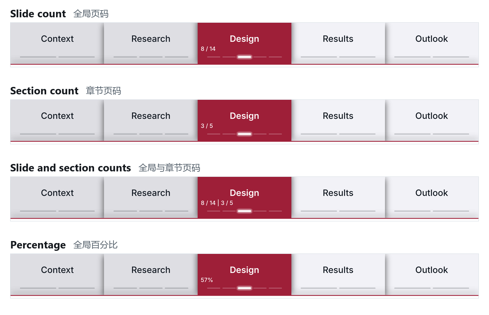
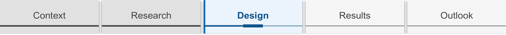
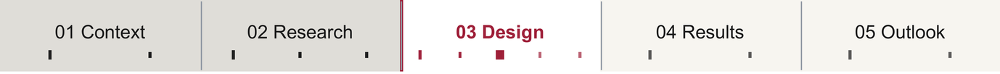
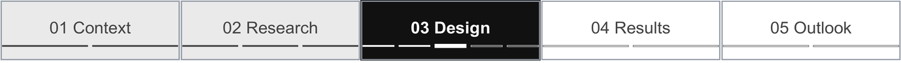
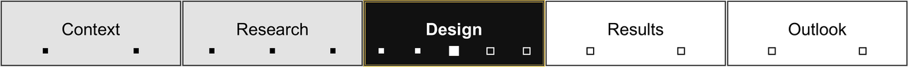

<p align="center"><a href="README.md"><picture><source media="(prefers-color-scheme: dark)" srcset="docs/assets/badges/lang-zh-en-dark.svg" /><source media="(prefers-color-scheme: light)" srcset="docs/assets/badges/lang-zh-en-light.svg" /></picture></a><!--
--><a href="README.zh-CN.md"><picture><source media="(prefers-color-scheme: dark)" srcset="docs/assets/badges/lang-zh-zh-dark.svg" /><source media="(prefers-color-scheme: light)" srcset="docs/assets/badges/lang-zh-zh-light.svg" /></picture></a></p>

<h1 align="center">PowerPoint 演讲进度条</h1>

<p align="center">
  <sub>本项目在 Olaf Nöhring 发布的 <strong>Progress Indicator 1.960</strong> 基础上开发并独立维护。</sub><br>
  <sub>这个 PowerPoint 加载项源自 Edward Loper 编写的 <em>Progress Dots</em> 宏，后来由 Adam M. Wilson 和 Olaf Nöhring 先后扩展。</sub><br>
  <sub><a href="https://github.com/AdamWilsonLab/progress_indicators">上游 GitHub 仓库（AdamWilsonLab/progress_indicators）</a> · <a href="https://datenbank-projekt.de/projekte/progress-indicator-powerpoint-2010-2013-2016-32-and-64-bit-windows-mac">Olaf Nöhring 的项目页</a></sub>
</p>

<p align="center"><sub>Windows 桌面版 PowerPoint &nbsp;|&nbsp; CN.11.10 / EN.11.10</sub></p>


<a id="关于"></a>

这个加载项用 PowerPoint 的节名在幻灯片上生成一条可点击的导航栏。放映时，观众能看到当前章节，以及这一章讲到了哪一页。点击章名可以跳到该章，点击代表某一页的短线或圆点，就能直接翻到那张幻灯片。

进度条和跳转链接都保存在文稿里。把文件发给别人，对方可以直接放映，重新生成进度条时才需要安装加载项。中英文版提供相同的 40 款样式。

<p align="center"><a href="#tutorial">下载与安装</a> · <a href="#preset-gallery">查看 40 款样式</a></p>

## 目录

- **制作进度条**　[安装和生成](#tutorial) · [位置与尺寸](#layout) · [章名与配色](#section-design) · [页码与页标](#counts)
- **管理文稿**　[局部更新与隐藏](#slide-updates) · [文稿预设与版式规则](#presentation-settings) · [40 款样式](#preset-gallery)
- **关于项目**　[与原版的区别](#upstream) · [源码构建](#build) · [许可与致谢](#license)

---

<a id="tutorial"></a>
<a id="安装与首次生成"></a>

## 安装并生成进度条

<a id="下载与安装"></a>

### 安装加载项

下载中文版或英文版，解压后安装其中的 `.ppam`。同包的 `.pptm` 用来查看和修改 VBA 源码。[全部发行版本](https://github.com/GH-X-ST/PowerPoint-Progress-Indicators/releases)

| 下载 | 解压后在 PowerPoint 中选择 |
| --- | --- |
| <a href="https://github.com/GH-X-ST/PowerPoint-Progress-Indicators/releases/download/CN.11.10/ProgressIndicators-CN.11.10.zip"><picture><source media="(prefers-color-scheme: dark)" srcset="docs/assets/badges/cn-dark.svg" /><source media="(prefers-color-scheme: light)" srcset="docs/assets/badges/cn-light.svg" /></picture></a> | `ProgressIndicators_v1960_3264b_SB_CN11_10.ppam` |
| <a href="https://github.com/GH-X-ST/PowerPoint-Progress-Indicators/releases/download/EN.11.10/ProgressIndicators-EN.11.10.zip"><picture><source media="(prefers-color-scheme: dark)" srcset="docs/assets/badges/en-dark.svg" /><source media="(prefers-color-scheme: light)" srcset="docs/assets/badges/en-light.svg" /></picture></a> | `ProgressIndicators_v1960_3264b_SB_EN11_10.ppam` |

1. 在 Windows 桌面版 PowerPoint 中打开 **文件 > 选项 > 加载项**。
2. 在窗口底部的 **管理** 列表中选择 **PowerPoint 加载项**，点击 **转到**。如果列表里已启用旧版或另一种语言的版本，先取消勾选。
3. 点击 **添加**，选中刚解压的 `.ppam`。按本机的宏安全要求启用后，功能区会出现 **演讲进度条** 选项卡。

<a id="生成与放映"></a>

### 给现有文稿添加导航

1. **给幻灯片分节。** 在左侧缩略图窗格中，找到新章的第一张幻灯片，右键点击它上方的间隙，选择 **新增节** 并输入章名。文稿已经分好节时，沿用现有节名即可。只需要页标时也可以不分节。[PowerPoint 分节说明](https://support.microsoft.com/zh-cn/powerpoint/training/organize-your-powerpoint-slides-into-sections)
2. **选一个样式。** 页首示例使用的是 **深红层叠**。在 **演讲进度条 > 设计样式 > 样式预设 > 层次** 中选中它，再选 **大号**。在 **生成** 组选择 **完整显示**，同时显示章名和页标。也可以选 **仅章节** 或 **仅图标**。
3. **先看效果。** 点 **预览**，加载项会从指定范围的第一张开始，给最多三张幻灯片加上进度条，跳过设置为不显示的页面。只想看正在编辑的这一页时，点 **局部更新与性能 > 更新当前页**。
4. **生成并放映。** 点 **生成** 为指定范围内的幻灯片添加进度条，完成后保存文稿。开始放映后，点击章名会跳到该章第一张计入进度的幻灯片。以后增删幻灯片、调换顺序或重新分节，再生成一次即可更新位置和链接。

---

<a id="layout"></a>
<a id="导航布局"></a>

## 调整位置、宽度和尺寸

<a id="停靠与长度分配"></a>

导航可以放在任一页边。在 **位置与显示 > 停靠边** 选择顶部或底部，章节会从左到右排列。选左侧或右侧时，章节和页标从上到下排列，章名仍然横着读。章名在侧栏里放不下，可以调大 **侧栏宽度 (pt)**。需要让进度条延伸到两端时，勾选 **设计样式 > 铺满当前边**。

<picture>
  <source media="(prefers-color-scheme: dark)" srcset="docs/assets/native/docking-dark.webp" />
  <source media="(prefers-color-scheme: light)" srcset="docs/assets/native/docking-light.webp" />
  
</picture>

<details>
<summary>各章一样宽，还是页数多的章更宽？</summary>

在 **生成** 组选择 **章节均长**，5 个章节就各占进度条的五分之一。选 **进度均长**，每张计入进度的幻灯片占相同长度。下面的例子共有 14 页，Design 章有 5 页，因此占整条可用长度的 5/14。

<picture>
  <source media="(prefers-color-scheme: dark)" srcset="docs/assets/native/spacing-dark.webp" />
  <source media="(prefers-color-scheme: light)" srcset="docs/assets/native/spacing-light.webp" />
  
</picture>

</details>

<a id="章体尺寸"></a>

### 大、中、小号

在预设名称下选择尺寸。以 **深红层叠** 为例，放在页面顶部或底部时，小号高约 16.67 pt，中号高 21.45 pt，大号高 44.2 pt。下图小号的 `Design` 距章体顶部 7 pt，字母 `g` 的下缘距当前页标的实心部分 2 pt。所有预设的小号都用 7 pt 的章名，页标厚度是同款大号的一半。大多数预设的小号页标两端各留 5% 的章宽，深红层叠的三种尺寸都各留 10%。

<picture>
  <source media="(prefers-color-scheme: dark)" srcset="docs/assets/native/sizes-dark.webp" />
  <source media="(prefers-color-scheme: light)" srcset="docs/assets/native/sizes-light.webp" />
  
</picture>

<details>
<summary>已有文稿如何采用 11.5 的尺寸？</summary>

重新选一次样式和尺寸，然后点 **生成**。与 11.4 相比，中号和大号的章节色块高了 30%。原高度每 10 pt，章名一侧多出 2 pt，页标与底边之间多出 1 pt。字号、页标厚度以及文字和页标的间距沿用原预设。对于带连接条的样式，三种尺寸的连接条均为 1 pt。

</details>

<a id="页标"></a>

### 更换页标

在 **圆角横条 > 标记形状** 中可以选择短条、刻度、圆点等六种形状，并调整厚度、间距、圆角或当前页的光晕。一章有很多页时，椭圆页标会沿排列方向变窄，厚度保持不变。要用 PowerPoint 形状或自己的图片，先取消勾选 **使用预设页标记**，再到 **进度图标** 中选择。

<picture>
  <source media="(prefers-color-scheme: dark)" srcset="docs/assets/native/markers-dark.webp" />
  <source media="(prefers-color-scheme: light)" srcset="docs/assets/native/markers-light.webp" />
  
</picture>

---

<a id="section-design"></a>
<a id="章节样式"></a>

## 设置章名、配色和分隔线

**长章名。** 在 **章节与字体** 中设置字体和字号。如果某个章名放不下，在 **文字与线条 > 长标题** 中选 **自动缩小适应** 可以保留全名，选 **末尾省略号** 则保留字号。英文大小写和标题对齐方式也在 **文字与线条** 中设置。要在章名前加序号，勾选 **设计样式 > 章节显示序号**。

<picture>
  <source media="(prefers-color-scheme: dark)" srcset="docs/assets/native/type-dark.webp" />
  <source media="(prefers-color-scheme: light)" srcset="docs/assets/native/type-light.webp" />
  
</picture>

**颜色和阴影。** 在 **章节色块** 中给已讲、当前和未讲的章节分别设底色和透明度。两侧渐变可以让离当前章较远的色块逐渐变淡。**层叠导航** 控制色块高度、各章的投影以及连接条的长度和厚度。顶部导航还可以把章名放大到 110% 至 300% 作为背景，超出本章的字母会被裁掉。这个选项在 **裁切背景字（顶部）** 中，只影响当前章以外的章节。

<picture>
  <source media="(prefers-color-scheme: dark)" srcset="docs/assets/native/surfaces-dark.webp" />
  <source media="(prefers-color-scheme: light)" srcset="docs/assets/native/surfaces-light.webp" />
  
</picture>

页首的 **深红层叠** 将当前章和底部的红色连接条连成一体。相邻的色块逐层相叠，越靠近当前章就越靠前。当前章名用 Inter SemiBold，其他章名用 Inter Medium。当前页的标记较厚，带有辉光。其余页标都是细条，透明度统一为 85%，包括当前章内的其他页。已讲和未讲章节沿用**轻盈层次**的两种灰色底色。在制作和放映电脑上都安装这两种字重，才能看到预设原有的字形。[下载 Inter](https://rsms.me/inter/)

<details>
<summary>给当前章加一道线，或在相邻章节之间加分隔线</summary>

在 **设计样式 > 当前章标记** 选择位置，在同组调整线条的粗细和颜色。导航放在顶部时，**内容侧线** 出现在章名下方，**外侧线** 在上方，**起点侧线** 在左侧。换到其他页边后，线条也跟着换边。

<picture>
  <source media="(prefers-color-scheme: dark)" srcset="docs/assets/native/accents-dark.webp" />
  <source media="(prefers-color-scheme: light)" srcset="docs/assets/native/accents-light.webp" />
  
</picture>

要分开相邻的章节，用 **文字与线条 > 平面线条**。这里有双线、三重分隔线、对位标记等八种画法，可以改线宽、换颜色，也可以关闭分隔线。

<picture>
  <source media="(prefers-color-scheme: dark)" srcset="docs/assets/native/section-lines-dark.webp" />
  <source media="(prefers-color-scheme: light)" srcset="docs/assets/native/section-lines-light.webp" />
  
</picture>

</details>

<details>
<summary>让没讲到的页标空心，或让深色底上的文字更清楚</summary>

在 **进度图标** 和 **设计样式** 中可以区分已讲、当前和未讲的页标，例如让未讲页显示空心标记，或让页标跟随章名的颜色。若章名和页标在底色上看不清，打开 **章节色块 > 文字与进度自动对比**。示例中，Design 仍是相同的深紫底，字和页标会换成白色。

<picture>
  <source media="(prefers-color-scheme: dark)" srcset="docs/assets/native/type-and-states-dark.webp" />
  <source media="(prefers-color-scheme: light)" srcset="docs/assets/native/type-and-states-light.webp" />
  
</picture>

</details>

<details>
<summary>让进度条使用幻灯片的主题色</summary>

启用 **位置与显示 > 跟随当前页主题** 后，进度条会使用该页母版的强调色 1 和主题的深浅色。背景是纯色时，加载项还会参考背景的明暗。图片或渐变背景则沿用主题配色。**通用主题** 在两种幻灯片主题下的效果如下。**深红层叠** 默认保留自己的配色。

<picture>
  <source media="(prefers-color-scheme: dark)" srcset="docs/assets/native/theme-dark.webp" />
  <source media="(prefers-color-scheme: light)" srcset="docs/assets/native/theme-light.webp" />
  
</picture>

</details>

---

<a id="counts"></a>
<a id="计数与密度"></a>

## 显示页码，精简长文稿的页标

同一张幻灯片，可以是全稿 14 页中的第 8 页，也可以是 Design 章 5 页中的第 3 页。在 **页码与密度 > 进度计数** 选择显示哪一种页码，或者两种都显示。也可以用百分比表示进度。这些数字按整份文稿计算。启用 **排除 > 跳过/沿用** 后，跳过的页面或沿用上一页进度的页面都不增加页数。

<picture>
  <source media="(prefers-color-scheme: dark)" srcset="docs/assets/native/counts-dark.webp" />
  <source media="(prefers-color-scheme: light)" srcset="docs/assets/native/counts-light.webp" />
  
</picture>

一章有几十页时，每一页都画一条短线会很挤。**页码与密度 > 进度密度** 有三种选择。切换时页码保持不变。

| 选项 | 哪些章保留逐页标记 |
| --- | --- |
| **全部页面** | 每一章都保留，每张计入进度的幻灯片一个标记。 |
| **自动密度** | 当前章始终保留。其他章的单个页标如果短于 **最短页条 (pt)**，那一章就只画一条长线。 |
| **聚焦当前章节** | 只展开当前章，其余每章各用一条长线表示。 |

下面是同一份 61 页文稿。选择自动密度后，Context 和 Results 中密集的短线各合成一条。Design 仍有五个页标，第三个发亮。

<picture>
  <source media="(prefers-color-scheme: dark)" srcset="docs/assets/native/density-dark.webp" />
  <source media="(prefers-color-scheme: light)" srcset="docs/assets/native/density-light.webp" />
  
</picture>

---

<a id="slide-updates"></a>
<a id="局部更新与生成统计"></a>

## 更新、移除或隐藏几页的进度条

只想改一页时，点 **局部更新与性能 > 更新当前页**。要改几页，在缩略图窗格或幻灯片浏览视图中多选，再点 **更新所选页**。起止页码仍然有效。例如，一份文稿有 14 页，全部计入进度。把范围设为第 5 到 10 页，同时选中第 4 页和第 8 页，只有第 8 页的进度条会更新，全稿页码仍是 8/14。

起止页码在 **生成** 组设置，不会随文稿保存。要连续调整几项样式，可以先关闭 **自动更新**，改好后再点 **生成**。

| 需要的效果 | 操作 |
| --- | --- |
| 清除已经画好的进度条 | 选中幻灯片，点 **移除所选页导航**。要清除整个页码范围，点 **生成 > 移除**。两种操作都会保留设置，下次生成可以把进度条加回来。 |
| 封面也算一页，但不显示进度条 | 选中封面，点 **所选页不显示导航**。以后再点生成，这页仍然不会出现进度条。要重新显示，点 **恢复所选页显示**，如果封面在生成范围内，且显示规则允许，这一页就会重新出现进度条。 |
| 某张幻灯片不计入进度 | 在 **当前页** 中选 **跳过**，并勾选 **排除 > 跳过/沿用**。跳过的页面没有进度条。选 **沿用** 会保留进度条，但显示上一张计入进度的幻灯片的位置。选 **正常** 可恢复计数。 |
| 不把 PowerPoint 的隐藏幻灯片计入总页数 | 勾选 **排除 > 隐藏页**。 |

长文稿可以启用 **局部更新与性能 > 复用同章导航**。在完整显示章名和逐页标记时，同一章中设置、主题、版式和背景相同的页面可以共用布局和阴影，每一页仍有自己的进度和跳转链接。**上次生成统计** 会显示这次用了多久、多少页复用了布局，以及阴影图的复用和 PNG 捕获次数。

---

<a id="presentation-settings"></a>
<a id="文稿配置与显示规则"></a>

## 保存样式，按母版或版式显示

<a id="保存和转移配置"></a>

### 保存常用样式

如果同一份文稿常在几套样式之间切换，在 **配置 > 我的文档预设** 中选择 **保存当前配置为文档预设** 并命名。下次从同一菜单找到它，点 **应用**，再重新生成。每份文稿最多可保存 32 套预设。

要把当前设置带到另一份文稿，在 **配置** 中点 **导出**，保存为 `.txt`。打开目标文稿，点 **导入** 并选中这个文件，加载项就会应用设置并开始更新。导出的文件只含当前这套设置。命名预设和母版、版式规则分别保存在原文稿里。

<a id="按母版或版式显示"></a>

### 只在正文显示，或给不同版式配不同样式

要让所有正文页都显示进度条，先在普通视图中选一张正文页。关闭多规则，在 **位置与显示 > 单一显示绑定** 中选择当前版式。以后只有采用这个版式的页面才会显示进度条。如果同一母版下的几种版式都需要进度条，就选择当前母版。这个设置随 `.pptx` 或 `.pptm` 文稿一起保存。

如果正文要显示进度条、同一母版下的封面却要留白，可以给母版和封面版式各存一条规则。

1. 在正文页调好样式，打开 **位置与显示 > 多母版与版式规则 > 为当前页面保存规则**，选择 **母版：显示并使用当前样式**。
2. 选一张封面，从同一菜单选 **版式：隐藏进度条**。保存规则会自动启用多规则。
3. 在 **未匹配页面** 中决定其余页面是否显示，然后点 **生成**。

每份文稿最多保存 32 条规则。如果同一页既符合版式规则也符合母版规则，优先用版式规则，因此这个例子里的封面会留白。手动设为 **所选页不显示导航** 的页面始终优先隐藏。以上设置只决定进度条画在哪里、用哪种样式，计数仍按整份文稿计算。

---

<a id="preset-gallery"></a>
<a id="40-款预设图册"></a>

## 全部 40 款样式

以下是正式加载项在同一张幻灯片上生成的 40 款进度条。每张图都停在 Design 章的第 3 页，方便对照当前章和页标的样子。在 **设计样式 > 样式预设** 中可以按相同的顺序找到它们。

### 通用

#### 通用主题


### 圆角与分段

#### 表现型胶囊


#### Bento 分段


#### 轻透胶囊


#### 柔和极简


### 排版与图形

#### 硬边错位


#### 复古终端


#### 衬线编辑


### 层次

#### 深红层叠


#### 轻盈层次


### 极简

#### 极简下沿线


#### 极简上沿线


### 调性

#### 柔和调性


#### 实色强调


### 柔影与轮廓

#### 柔影侧标



#### 精细轮廓


### 编辑排版

#### 编号编辑风



#### 黑白网格



### 高对比

#### 高对比浅色



#### 高对比深色


### 半透明材质

#### 浅色半透明


#### 深色半透明


### 技术视觉

#### 暗色荧光


#### 蓝图线框


### 渐变

#### 双色调渐变


#### 距离渐淡


### 材质与硬边

#### 暖纸柔影


#### 硬边图形


### 框景与标注

#### 舞台方窗


#### 工程定位


#### 都市围框


#### 分区字格


### 编辑与档案

#### 静默书目


#### 字样索引


#### 轻字标本


#### 档案标签


### 色带与图形节奏

#### 海岸色带


#### 泳道单线


#### 报刊分栏


#### 柜格序列


---

<a id="upstream"></a>
<a id="与原版-1960-的功能对照"></a>

## 与原版 1.960 的区别

1.960 版已经支持点击章名或图标跳页、按章节或页数分配宽度，以及用自定义图片做页标。按页码范围生成和移除、预览、自动更新、跳过或沿用进度、排除隐藏页和导入导出设置，也都来自原版。[原作者的项目页](https://datenbank-projekt.de/projekte/progress-indicator-powerpoint-2010-2013-2016-32-and-64-bit-windows-mac) · [1.960 随附说明](original/ProgressIndicators_v1960_3264b/README.md)

### 本版新增

- **导航外观。** 进度条可以放在幻灯片的任一边，侧栏宽度可调，也可以铺满整条边。40 款预设组合了逐页标记、章节分隔线、渐变、投影和连接条。章名可以编号、缩小或截短，配色可以跟随当前幻灯片的主题。
- **进度显示。** 可以显示全稿或章内的页码和百分比。长文稿中，可以合并过密的页标，或只展开当前章节。
- **更新范围。** 可以更新或移除选中页的进度条，单独为封面保存隐藏设置，也可以按母版或版式选择哪些页面显示哪种样式。长文稿可复用同章布局和阴影，并查看生成耗时。
- **设置与语言。** 除了随文稿保存当前设置，每份文稿还可以把多套样式分别命名保存。加载项提供独立的简体中文和英文版本。

---

<a id="build"></a>

## 从源码构建

VBA 模块、窗体和功能区 XML 在 `source/` 中。修改预设参数时，同步更新 `styles.json` 和 `source/mdlProgressIndicator.bas` 中的 `PI_StyleRecipe`。构建时会用 `original/` 中的上游文件作模板，保留窗体资源和 VBA 工程属性。

要构建可编辑的中文版 `.pptm`，先在 Windows 上安装 uv，再在仓库根目录打开 PowerShell。

```powershell
uv venv --python 3.12 .venv
uv pip install --python .venv\Scripts\python.exe -r requirements-build.txt
.\.venv\Scripts\python.exe build_package.py --output-dir rebuild --version-token CN11_10 --report rebuild\package-validation.json
```

输出文件是 `rebuild/ProgressIndicators_v1960_3264b_SB_CN11_10.pptm`。要得到可安装的 `.ppam`，用发布脚本调用 Windows 桌面版 PowerPoint 另存这份文稿。[中文版构建与发布说明](BUILD_zh-CN.txt)

<a id="license"></a>
<a id="许可证与署名"></a>

## 许可与致谢

本项目沿用 MIT 许可证。原作的版权声明署名 Edward Loper、Adam M. Wilson 和 Olaf Nöhring。原版功能区使用的 FatCow Farm-Fresh Web Icons 采用 CC BY 3.0 US 许可。[MIT 许可证](LICENSE) · [第三方图标与版权声明](THIRD_PARTY_NOTICES.md)
