<p align="center"><a href="README.md"><picture><source media="(prefers-color-scheme: dark)" srcset="docs/assets/badges/lang-zh-en-dark.svg" /><source media="(prefers-color-scheme: light)" srcset="docs/assets/badges/lang-zh-en-light.svg" /></picture></a><!--
--><a href="README.zh-CN.md"><picture><source media="(prefers-color-scheme: dark)" srcset="docs/assets/badges/lang-zh-zh-dark.svg" /><source media="(prefers-color-scheme: light)" srcset="docs/assets/badges/lang-zh-zh-light.svg" /></picture></a></p>

<p align="center">
  <sub>本项目基于 Olaf Nöhring 发布的 <strong>Progress Indicator 1.960</strong>，现独立维护。</sub><br>
  <sub>项目源于 Edward Loper 为 PowerPoint 编写的 <em>Progress Dots</em> 宏，后来由 Adam M. Wilson 和 Olaf Nöhring 先后改进。</sub><br>
  <sub><a href="https://github.com/AdamWilsonLab/progress_indicators">上游仓库 · AdamWilsonLab/progress_indicators</a> · <a href="https://datenbank-projekt.de/projekte/progress-indicator-powerpoint-2010-2013-2016-32-and-64-bit-windows-mac">Olaf Nöhring 的项目页</a></sub>
</p>


## 关于

Progress Indicators 可以给 Windows 桌面版 PowerPoint 的幻灯片加上一条章节导航栏。它沿用文稿里的节名，标出现在讲到哪一章、哪一页。放映时，点击章节名可以跳到该章，点击章名下的短线或圆点（页标）可以跳到对应的幻灯片。

进度条和链接都保存在演示文稿里。把文件发给同事，对方也可以直接用 PowerPoint 放映和跳页。加载项提供中英文两个版本，都有 40 款样式可选。

## 目录

- [下载安装](#tutorial) · [生成第一条进度条](#生成与放映)
- [调整位置和尺寸](#layout) · [设置章名、配色和分隔线](#section-design)
- [显示页码，简化长章节的页标](#counts) · [更新、移除或隐藏进度条](#slide-updates)
- [保存常用样式，按版式显示](#presentation-settings) · [全部 40 款样式](#preset-gallery)
- [与原版的区别](#upstream) · [从源码构建](#build) · [许可与致谢](#license)

---

<a id="tutorial"></a>
<a id="安装与首次生成"></a>
<a id="下载与安装"></a>

## 安装加载项

按你想用的界面语言下载并解压。安装时选择 `.ppam` 文件。想查看或修改 VBA 源码，可以打开同一压缩包里的 `.pptm`。[全部发行版本](https://github.com/GH-X-ST/PowerPoint-Progress-Indicators/releases)

| 下载 | 安装时选择的文件 |
| --- | --- |
| <a href="https://github.com/GH-X-ST/PowerPoint-Progress-Indicators/releases/download/CN.11.10/ProgressIndicators-CN.11.10.zip"><picture><source media="(prefers-color-scheme: dark)" srcset="docs/assets/badges/cn-dark.svg" /><source media="(prefers-color-scheme: light)" srcset="docs/assets/badges/cn-light.svg" /></picture></a> | `ProgressIndicators_v1960_3264b_SB_CN11_10.ppam` |
| <a href="https://github.com/GH-X-ST/PowerPoint-Progress-Indicators/releases/download/EN.11.10/ProgressIndicators-EN.11.10.zip"><picture><source media="(prefers-color-scheme: dark)" srcset="docs/assets/badges/en-dark.svg" /><source media="(prefers-color-scheme: light)" srcset="docs/assets/badges/en-light.svg" /></picture></a> | `ProgressIndicators_v1960_3264b_SB_EN11_10.ppam` |

1. 在 PowerPoint 中打开 **文件 → 选项 → 加载项**。
2. 在窗口底部的 **管理** 列表中选择 **PowerPoint 加载项**，点击 **转到**。如果已启用旧版或另一种语言的版本，先取消勾选。
3. 点击 **添加**，选中解压得到的 `.ppam`。启用后，功能区会出现 **演讲进度条** 选项卡。下文的按钮名称以中文版为准。

<a id="生成与放映"></a>

### 第一次使用

1. **给文稿分节。** 在左侧缩略图窗格中，右键点击两张幻灯片之间的空隙，选择 **新增节**，输入章节名。已分节的文稿可以直接使用现有节名。[PowerPoint 分节说明](https://support.microsoft.com/zh-cn/powerpoint/training/organize-your-powerpoint-slides-into-sections)
2. **选一个样式。** 打开 **演讲进度条 → 设计样式 → 样式预设**，在“层次”分组下找到 **深红层叠**，选 **大号**。在 **生成** 组选择 **完整显示**，就能同时看到章名和页标。
3. **生成进度条。** 点击 **生成**，完成后保存文稿。开始放映，试着点击另一个章节名，PowerPoint 会跳到该章第一张计入进度的幻灯片。

想先看效果，可以点 **预览**。加载项会从指定范围的第一页开始，跳过设为不显示的页面，最多为三张幻灯片生成进度条。只想试当前这一页，点 **局部更新与性能 → 更新当前页**。

如果只需要逐页标记，选 **仅图标**，文稿也可以不分节。只想显示章节名，选 **仅章节**。

---

<a id="layout"></a>
<a id="导航布局"></a>
<a id="停靠与长度分配"></a>

## 调整位置和尺寸

在 **位置与显示 → 停靠边** 选择顶部、底部、左侧或右侧。放在侧边时，各章从上往下排列，章名仍然横排。章名放不下，可以增大 **侧栏宽度 (pt)**。

勾选 **设计样式 → 铺满当前边**，进度条会延伸到幻灯片两端。想在两端留白，可以在 **布局** 中调整起点和终点的留白。

<picture>
  <source media="(prefers-color-scheme: dark)" srcset="docs/assets/native/docking-dark.webp" />
  <source media="(prefers-color-scheme: light)" srcset="docs/assets/native/docking-light.webp" />
  
</picture>

### 各章应该占多宽？

在 **生成** 组可以选择各章等宽，也可以让页数多的章节占得更宽。下图的文稿共 5 章、14 页，其中 Design 章有 5 页。

| 选项 | Design 章占多宽 |
| --- | --- |
| **章节均长** | 五个章节一样宽，Design 占整条的 1/5。 |
| **进度均长** | 按计入进度的页数分配。Design 有 5 页，占整条的 5/14。 |

<picture>
  <source media="(prefers-color-scheme: dark)" srcset="docs/assets/native/spacing-dark.webp" />
  <source media="(prefers-color-scheme: light)" srcset="docs/assets/native/spacing-light.webp" />
  
</picture>

<a id="章体尺寸"></a>

### 选择大、中、小号

每款预设都有大、中、小三号，选中样式名称后就能看到。下图用同一张幻灯片对比了“深红层叠”的三种尺寸。

<picture>
  <source media="(prefers-color-scheme: dark)" srcset="docs/assets/native/sizes-dark.webp" />
  <source media="(prefers-color-scheme: light)" srcset="docs/assets/native/sizes-light.webp" />
  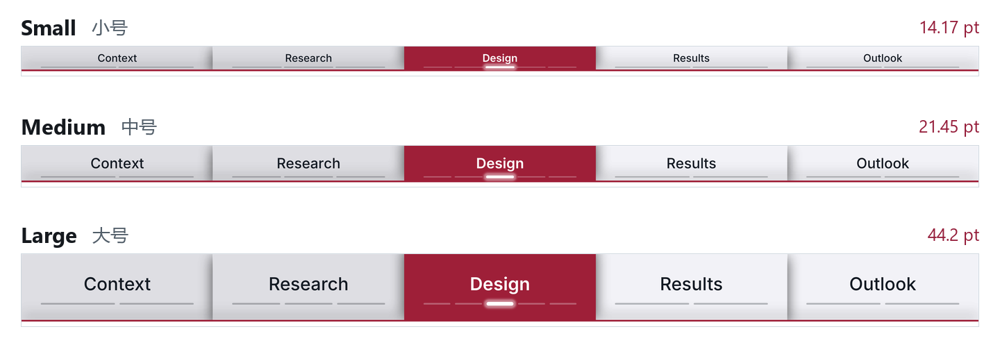
</picture>

<details>
<summary>查看尺寸和留白</summary>

- 进度条横排时，深红层叠的小、中、大号章节色块分别高约 **16.67、21.45、44.2 pt**。多数其他预设的小号色块高 13 pt。
- 小号的章节名用 7 pt 字号，页标厚度为同款大号的一半。上图的 `Design` 距色块顶边 7 pt，字母 `g` 的下缘距当前页标的实心边缘 2 pt。
- 深红层叠的一排页标在三种尺寸下都占本章宽度的 80%，左右各留 10%。多数其他预设的小号左右各留 5%。带连接条的预设，三种尺寸的连接条都厚 1 pt。

要让旧文稿采用当前尺寸，重新选择预设和大小，再点 **生成**。

</details>

<a id="页标"></a>

### 更换页标

打开 **圆角横条 → 标记形状**，可以选圆角短条、直角分段、尺规刻度、圆节点、连续轨道与游标或方形页格。页标的高度、间距、圆角和当前页的光晕都在这一组调整。一章的页数较多时，椭圆页标会沿排列方向变窄，厚度保持不变。

<picture>
  <source media="(prefers-color-scheme: dark)" srcset="docs/assets/native/markers-dark.webp" />
  <source media="(prefers-color-scheme: light)" srcset="docs/assets/native/markers-light.webp" />
  
</picture>

想用自己的图片或 PowerPoint 自带的形状，先取消勾选 **圆角横条 → 使用预设页标记**，再到 **进度图标** 中选择。

---

<a id="section-design"></a>
<a id="章节样式"></a>

## 设置章名、配色和分隔线

### 章名太长怎么办？

**章节与字体** 可以调整字体和字号。只想处理放不下的章名，打开 **文字与线条 → 长标题**，选 **自动缩小适应** 就能显示全名。也可以选 **末尾省略号**，保留原字号，截短进度条上的文字。两种设置都不会改动文稿里的节名。

<picture>
  <source media="(prefers-color-scheme: dark)" srcset="docs/assets/native/type-dark.webp" />
  <source media="(prefers-color-scheme: light)" srcset="docs/assets/native/type-light.webp" />
  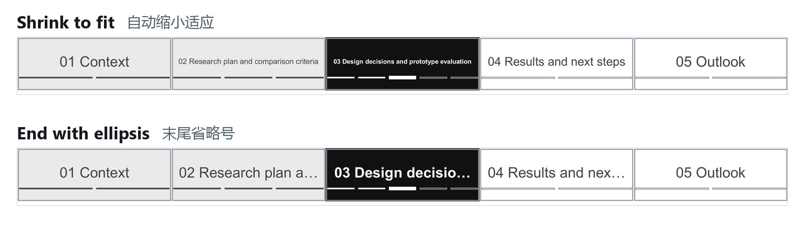
</picture>

在 **文字与线条** 中还可以调整标题对齐方式，或把英文章名改成大写。需要给各章编号或加粗当前章名时，在 **设计样式** 中勾选 **章节显示序号** 或 **加粗当前章标题**。

### 给章节配色

在 **章节与字体** 中分别设置已讲、当前和未讲章节的底色。要调透明度，或让当前章两侧的颜色由近到远逐渐变化，打开 **章节色块**。各章的投影和底部连接条在 **层叠导航** 中调整。

下图中间一行在 Research 和 Results 的章名后面叠了一层放大的文字。这个效果在顶部导航可用。勾选 **裁切背景字（顶部） → 非当前章节背景字** 后，可以把背景文字放大到 110% 至 300%，超出各章边界的部分会被裁掉。

<picture>
  <source media="(prefers-color-scheme: dark)" srcset="docs/assets/native/surfaces-dark.webp" />
  <source media="(prefers-color-scheme: light)" srcset="docs/assets/native/surfaces-light.webp" />
  
</picture>

“深红层叠”的当前章与底部红条连成一片。两侧章节逐层向后排列，离当前章越近，色块越靠前。当前页的短条较厚，带有光晕。其余页标都是细条，透明度为 85%，包括当前章里的其他页。两侧章节的底色与“轻盈层次”相同，用深浅两种灰色区分已讲和未讲的章节。

要还原图中的字形，请在编辑和放映用的电脑上安装 Inter。当前章使用 Inter SemiBold，其他章使用 Inter Medium。[下载 Inter](https://rsms.me/inter/)

<details>
<summary>突出当前章，或给各章加分隔线</summary>

要突出所在章节，可以在 **设计样式 → 当前章标记** 中选一条边。以顶部导航为例，**内容侧线** 在章名下方，**外侧线** 在上方，**起点侧线** 在左侧。也可以选 **内侧轮廓**，给当前章加一圈边框。线条颜色和粗细在同一组设置。

<picture>
  <source media="(prefers-color-scheme: dark)" srcset="docs/assets/native/accents-dark.webp" />
  <source media="(prefers-color-scheme: light)" srcset="docs/assets/native/accents-light.webp" />
  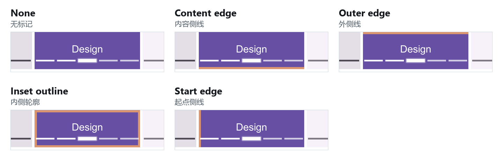
</picture>

要分清所有相邻章节，打开 **文字与线条 → 平面线条**。共有八种线条样式，包括双横线、三重分隔线和对位标记，也可以选择 **关闭**。

<picture>
  <source media="(prefers-color-scheme: dark)" srcset="docs/assets/native/section-lines-dark.webp" />
  <source media="(prefers-color-scheme: light)" srcset="docs/assets/native/section-lines-light.webp" />
  
</picture>

</details>

<details>
<summary>把未讲页标改成空心，或提高文字对比度</summary>

勾选 **设计样式 → 未讲页空心横条**，可以区分已讲和未讲的页面。勾选同组的 **横条跟随章节配色**，页标就会使用章名的颜色。如果深色底上的章名看不清，可以打开 **章节色块 → 文字与进度自动对比**。下图中，Design 仍是深紫底，章名和页标都变成了白色。

<picture>
  <source media="(prefers-color-scheme: dark)" srcset="docs/assets/native/type-and-states-dark.webp" />
  <source media="(prefers-color-scheme: light)" srcset="docs/assets/native/type-and-states-light.webp" />
  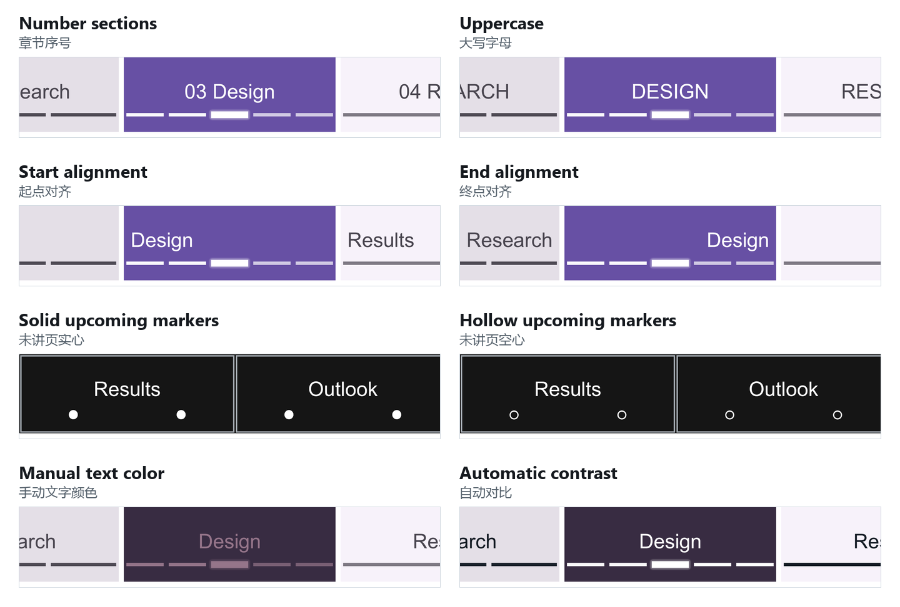
</picture>

</details>

<details>
<summary>让进度条跟随幻灯片的主题色</summary>

启用 **位置与显示 → 跟随当前页主题** 后，当前章使用该页母版的“强调色 1”，其余章节使用主题的深浅色。如果幻灯片用纯色背景，进度条的配色还会随背景明暗调整。下图是“通用主题”在两种母版下的效果。“深红层叠”默认使用自己的配色。

<picture>
  <source media="(prefers-color-scheme: dark)" srcset="docs/assets/native/theme-dark.webp" />
  <source media="(prefers-color-scheme: light)" srcset="docs/assets/native/theme-light.webp" />
  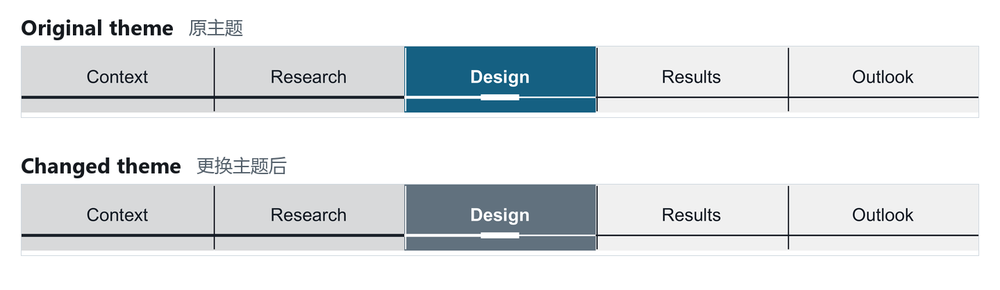
</picture>

</details>

---

<a id="counts"></a>
<a id="计数与密度"></a>

## 显示页码，简化长章节的页标

### 显示整份文稿或章内的页码

同一张幻灯片可以是全稿的第 8 页，也是 Design 章的第 3 页。打开 **页码与密度 → 进度计数**，选 **全局与章节页码**，即可同时看到 `8/14` 和 `3/5`。也可以只显示其中一种，或改用百分比。即使只更新几张幻灯片，页码仍按整份文稿计算。

<picture>
  <source media="(prefers-color-scheme: dark)" srcset="docs/assets/native/counts-dark.webp" />
  <source media="(prefers-color-scheme: light)" srcset="docs/assets/native/counts-light.webp" />
  
</picture>

### 一章有几十页时

一章里的短线太密，可以在 **页码与密度 → 进度密度** 中收起其他章节的页标。三种选项只改变画法，页码照常计算。

| 选项 | 进度条怎么显示 |
| --- | --- |
| **全部页面** | 每张计入进度的幻灯片各有一个页标。 |
| **自动密度** | 当前章保留所有页标。其他章只要单个页标短于 **最短页条 (pt)**，整章就合成一条线。 |
| **聚焦当前章节** | 只有当前章逐页显示，其他章各用一条线。 |

下图用的是同一份 61 页文稿。选 **自动密度** 后，页数较多的 Context 和 Results 各收成一条线。当前的 Design 章仍有五个页标，第三个发亮。

<picture>
  <source media="(prefers-color-scheme: dark)" srcset="docs/assets/native/density-dark.webp" />
  <source media="(prefers-color-scheme: light)" srcset="docs/assets/native/density-light.webp" />
  
</picture>

---

<a id="slide-updates"></a>
<a id="局部更新与生成统计"></a>

## 更新、移除或隐藏进度条

增删幻灯片、调整顺序或重新分节后，点 **生成** 更新页标和跳转链接。起止页码也在 **生成** 组设置，不随文稿保存。连续调整几项外观时，可以先关掉 **自动更新**，改好再生成。

只改一页，点 **局部更新与性能 → 更新当前页**。改几页，先在缩略图窗格或幻灯片浏览视图中多选，再点 **更新所选页**。所选页还要落在生成范围内。例如，范围设为第 5 至 10 页，同时选中第 4 页和第 8 页，只会更新第 8 页。

| 想达到的效果 | 操作 |
| --- | --- |
| 删掉已经生成的进度条 | 选中幻灯片，点 **移除所选页导航**。要清除指定范围内的所有进度条，点 **生成 → 移除**。设置仍然保留，下次可以重新生成。 |
| 封面算一页，但不显示进度条 | 选中封面，点 **所选页不显示导航**。重新生成时封面也会留白。要加回来，点 **恢复所选页显示**，再按当前范围和版式规则生成。 |
| 某一页不计入进度 | 勾选 **排除 → 跳过/沿用**。在 **当前页** 组选 **跳过**，该页就不显示进度条。选 **沿用** 则会显示进度条，页标停在上一张计入进度的幻灯片上。两种方式都不增加页数，选 **正常** 可恢复计数。 |
| 排除 PowerPoint 中已隐藏的幻灯片 | 勾选 **排除 → 隐藏页**，这些幻灯片就不计入总页数。 |

如果长文稿生成较慢，可以勾选 **局部更新与性能 → 复用同章导航**。在 **完整显示** 和 **全部页面** 模式下，同章中样式、主题、版式和背景都相同的页可以共用布局和阴影。每一页仍有自己的高亮标记和链接。打开 **上次生成统计** 可以查看耗时、复用布局的页数，以及阴影图的生成和复用次数。

---

<a id="presentation-settings"></a>
<a id="文稿配置与显示规则"></a>

## 保存常用样式，按版式显示

<a id="保存和转移配置"></a>

### 下次继续用这套样式

在 **配置 → 我的文档预设** 中选择 **保存当前配置为文档预设**，给这套设置起个名字。下次打开同一份文稿，从这个菜单找到它，点 **应用** 后重新生成即可。每份文稿最多可以保存 32 套。

要把当前这套设置用到另一份文稿，在 **配置** 中点 **导出**，保存为 `.txt` 文件。在目标文稿中点 **导入** 并选中该文件，加载项会应用设置并更新进度条。导出的文件只包含当前设置。在文稿里另存的其他预设和显示规则仍留在原文稿中。

<a id="按母版或版式显示"></a>

### 让正文有进度条，封面留白

如果正文页都用同一个版式，先选中一张正文页。关闭多规则，再选择 **位置与显示 → 单一显示绑定 → 绑定当前页的版式**。采用这个版式的页面才会显示进度条。如果要覆盖同一母版下的所有版式，选 **绑定当前页的母版**。保存 `.pptx` 或 `.pptm` 时，绑定关系会一并保存。

如果正文用了多种版式，但它们和封面共用一个母版，可以让整套母版显示进度条，再给封面版式单设一条规则。

1. 在正文页调好样式。打开 **位置与显示 → 多母版与版式规则 → 为当前页面保存规则**，选择 **母版：显示并使用当前样式**。
2. 切换到封面，在同一菜单中选择 **版式：隐藏进度条**。保存规则后，多规则会自动启用。
3. 在 **未匹配页面** 中选择其余页面是否显示进度条，然后点 **生成**。

同一张幻灯片同时匹配两条规则时，版式优先于母版，因此封面可以单独留白。手动设为 **所选页不显示导航** 的页面，即使符合显示规则，也不会出现进度条。每份文稿最多可保存 32 条规则，规则只决定进度条的外观和显示位置，页数仍按整份文稿计算。

---

<a id="preset-gallery"></a>
<a id="40-款预设图册"></a>

## 全部 40 款样式

下面 40 张图都是加载项在 PowerPoint 中生成的进度条。每张图都停在 Design 章的第 3 页，方便比较各款样式怎样标出当前章节和页面。分组顺序与 **设计样式 → 样式预设** 菜单一致。

喜欢简洁的细线，可以先看[极简下沿线](#极简下沿线)。[深红层叠](#深红层叠)用阴影分出章节的前后层次，[蓝图线框](#蓝图线框)则用一排刻度标出页次。

### 通用

#### 通用主题

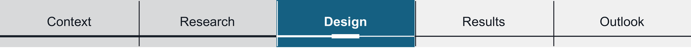

### 圆角与分段

#### 表现型胶囊


#### Bento 分段


#### 轻透胶囊


#### 柔和极简


### 排版与图形

#### 硬边错位

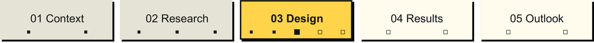

#### 复古终端

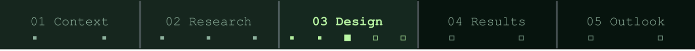

#### 衬线编辑


### 层次

#### 深红层叠


#### 轻盈层次

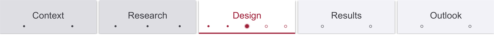

### 极简

#### 极简下沿线

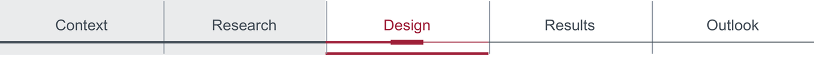

#### 极简上沿线

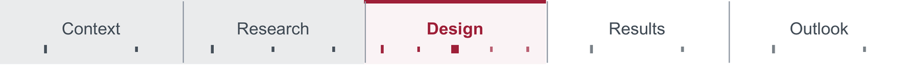

### 调性

#### 柔和调性


#### 实色强调

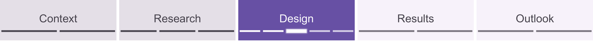

### 柔影与轮廓

#### 柔影侧标


#### 精细轮廓

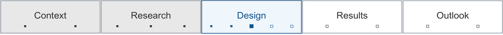

### 编辑排版

#### 编号编辑风


#### 黑白网格


### 高对比

#### 高对比浅色


#### 高对比深色

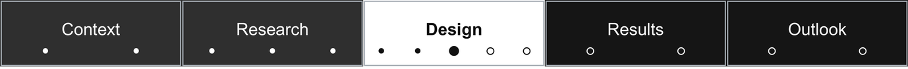

### 半透明材质

#### 浅色半透明


#### 深色半透明


### 技术视觉

#### 暗色荧光


#### 蓝图线框

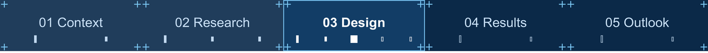

### 渐变

#### 双色调渐变

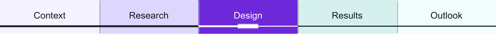

#### 距离渐淡

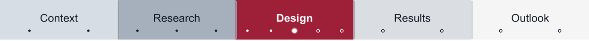

### 材质与硬边

#### 暖纸柔影

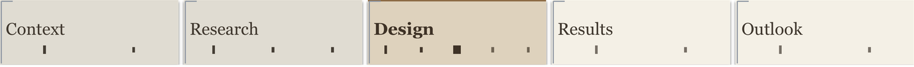

#### 硬边图形

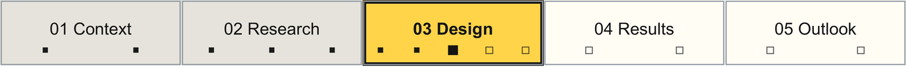

### 框景与标注

#### 舞台方窗

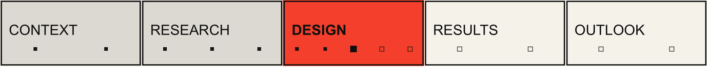

#### 工程定位

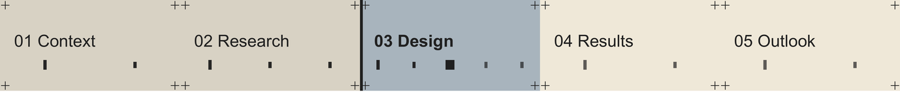

#### 都市围框


#### 分区字格

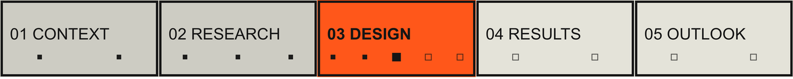

### 编辑与档案

#### 静默书目


#### 字样索引


#### 轻字标本


#### 档案标签


### 色带与图形节奏

#### 海岸色带


#### 泳道单线

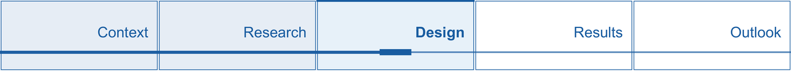

#### 报刊分栏

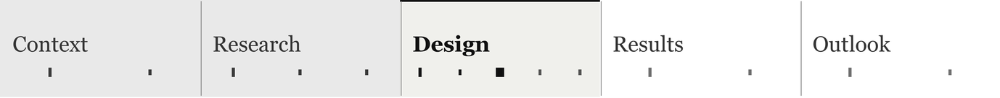

#### 柜格序列


---

<a id="upstream"></a>
<a id="与原版-1960-的功能对照"></a>

## 与原版 1.960 的区别

点击章节名或页标跳页、按章节或页数分配宽度、自定义页标图片，这些功能在 Progress Indicator 1.960 中就已提供。原版也支持按范围生成或移除进度条、预览、自动更新、跳过或沿用进度、排除隐藏页，以及导入和导出设置。[阅读原版说明](original/ProgressIndicators_v1960_3264b/README.md) · [原作者的项目页](https://datenbank-projekt.de/projekte/progress-indicator-powerpoint-2010-2013-2016-32-and-64-bit-windows-mac)

| 本版增加的功能 | 用法 |
| --- | --- |
| 40 款预设，各有三种尺寸。进度条可以放在幻灯片的任一边，放在左侧或右侧时可调宽度。 | [样式图册](#preset-gallery) · [位置和尺寸](#layout) |
| 按幻灯片主题配色，设置长章名、分隔线、渐变、背景字、投影和连接条。 | [章名和配色](#section-design) |
| 显示全稿或章内页码、百分比，收起长章节中过密的页标。 | [页码和页标](#counts) |
| 单独更新或隐藏所选页，在同一章内复用布局和阴影，查看生成耗时。 | [更新和隐藏](#slide-updates) |
| 在同一份文稿里保存多套命名样式，给不同母版和版式指定显示规则。 | [预设和规则](#presentation-settings) |

本版分别提供简体中文和英文加载项，两者功能相同。

---

<a id="build"></a>

## 从源码构建

要构建可编辑的中文版 `.pptm`，先在 Windows 上安装 uv，然后在仓库根目录打开 PowerShell，运行以下命令。

```powershell
uv venv --python 3.12 .venv
uv pip install --python .venv\Scripts\python.exe -r requirements-build.txt
.\.venv\Scripts\python.exe build_package.py --output-dir rebuild --version-token CN11_10 --report rebuild\package-validation.json
```

输出文件为 `rebuild/ProgressIndicators_v1960_3264b_SB_CN11_10.pptm`。要生成可安装的 `.ppam`，再用仓库中的发布脚本调用 Windows 桌面版 PowerPoint 另存为加载项。[中文版构建与发布说明](BUILD_zh-CN.txt)

VBA 模块、窗体和功能区 XML 位于 `source/`。修改内置样式时，要同时更新 `styles.json` 和 `source/mdlProgressIndicator.bas` 中的 `PI_StyleRecipe`。构建器使用 `original/` 中的原版文件作模板，以保留窗体资源和 VBA 工程属性。

<a id="license"></a>
<a id="许可证与署名"></a>

## 许可与致谢

原作由 Edward Loper、Adam M. Wilson 和 Olaf Nöhring 开发，本项目沿用原作的 MIT 许可证。功能区中沿用的 FatCow Farm-Fresh Web Icons 图标按 CC BY 3.0 US 授权。[MIT 许可证](LICENSE) · [第三方图标及版权声明](THIRD_PARTY_NOTICES.md)
