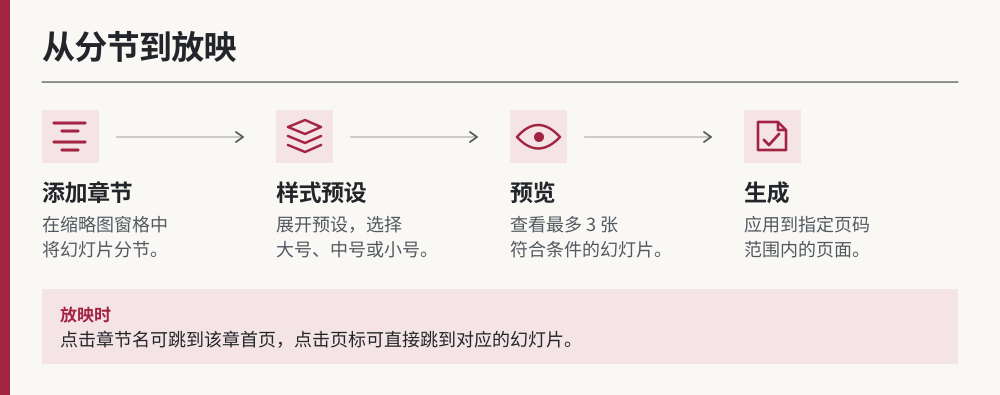
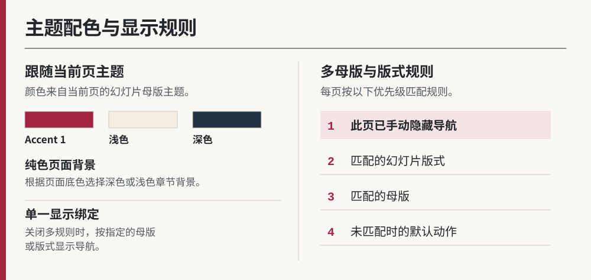

<p align="center"><a href="README.md" lang="en">English</a> / <strong>简体中文</strong></p>

<p align="center">
<a href="https://github.com/GH-X-ST/PowerPoint-Progress-Indicators/releases/download/CN.11.5/ProgressIndicators-CN.11.5.zip">
<picture>
  <source media="(prefers-color-scheme: dark)" srcset="docs/assets/badges/cn-dark.svg" />
  <source media="(prefers-color-scheme: light)" srcset="docs/assets/badges/cn-light.svg" />
  
</picture>
</a>
<a href="https://github.com/GH-X-ST/PowerPoint-Progress-Indicators/releases/download/EN.11.5/ProgressIndicators-EN.11.5.zip">
<picture>
  <source media="(prefers-color-scheme: dark)" srcset="docs/assets/badges/en-dark.svg" />
  <source media="(prefers-color-scheme: light)" srcset="docs/assets/badges/en-light.svg" />
  
</picture>
</a>
</p>

<picture>
  <source media="(prefers-color-scheme: dark)" srcset="docs/assets/hero-zh-dark.svg" />
  <source media="(prefers-color-scheme: light)" srcset="docs/assets/hero-zh-light.svg" />
  
</picture>

这是 Olaf Nöhring 的 Progress Indicator 1.960 的独立维护版本。它把 PowerPoint 文稿的章节和页序做成放映时可点击的导航。下图中的导航均由正式 11.5 加载项在 Windows 桌面 PowerPoint 中生成。

[使用教程](#tutorial) | [40 款原生图册](#preset-gallery) | [与原版的区别](#upstream) | [从源码构建](#build)

<a name="tutorial"></a>

## 使用教程

### 安装后生成第一条导航

下载页首的中文或英文 ZIP。安装其中的 **`.ppam`**，同包的 **`.pptm`** 用于在 PowerPoint 中查看或修改 VBA 源码。 [全部发行版本](https://github.com/GH-X-ST/PowerPoint-Progress-Indicators/releases)

<picture>
  <source media="(prefers-color-scheme: dark)" srcset="docs/assets/workflow-zh-dark.svg" />
  <source media="(prefers-color-scheme: light)" srcset="docs/assets/workflow-zh-light.svg" />
  
</picture>

1. 解压所选语言的发布包。在 Windows 桌面 PowerPoint 中打开 **文件 > 选项 > 加载项**，在底部的 **管理** 中选择 **PowerPoint 加载项**，点击 **转到 > 添加**，选中解压后的 `.ppam`，按本机现有的宏授权流程启用。一次启用一种语言版本。安装完成后，功能区会出现 **演讲进度条** 选项卡。
2. 打开要放映的文稿。在左侧缩略图窗格中，右键点击新章节起始处的幻灯片间隙，选择 **新增节**，为它命名。例如，把演讲分为“背景”“方法”“结果”。加载项读取这些节名作为导航标题；没有命名章节的文稿也能使用逐页标记。[Microsoft 的分节说明](https://support.microsoft.com/zh-cn/powerpoint/training/organize-your-powerpoint-slides-into-sections)
3. 在 **演讲进度条 > 设计样式 > 样式预设** 中展开一种样式，再选择 **大号**、**中号** 或 **小号**。例如，在“层次”下找到 **深红层叠**。在 **位置与显示 > 停靠边** 选择摆放导航的一边，给原标题、校徽或页脚留出空间。
4. 在 **生成** 组选择 **完整显示**。其中，**章节均长** 让三个章节各占三分之一；**进度均长** 按计入进度的页数分配长度，例如有 2、6、4 页的三个章节分别占 2/12、6/12 和 4/12。需要单独显示章节名或图标时，可在同一组选 **仅章节** 或 **仅图标**。
5. 选择 **局部更新与性能 > 更新当前页** 查看正在编辑的页面。也可以点 **生成 > 预览**，用当前配置实际更新指定范围中最先符合条件的最多三页。确认后点 **生成 > 生成**，保存文稿。开始放映，点击章节名可跳到该章首张计入进度的页面，点击独立页标可跳到对应页。之后增删幻灯片或移动章节，再点 **生成** 更新页序和链接。

### 把导航放在哪一边

在 **位置与显示 > 停靠边** 选择顶部、底部、左侧或右侧。侧栏里的章名仍是横排，页标沿侧边排列。用 **侧栏宽度 (pt)** 给长章名留出空间，或用 **设计样式 > 铺满当前边** 让导航占满该边。

<picture>
  <source media="(prefers-color-scheme: dark)" srcset="docs/assets/native/docking-dark.webp" />
  <source media="(prefers-color-scheme: light)" srcset="docs/assets/native/docking-light.webp" />
  
</picture>

<details>
<summary>对照两种均长方式</summary>

示例中五章各有 2、3、5、2、2 页。选 **章节均长** 时五章一样宽；选 **进度均长** 时，5 页的 Design 章占导航长度的 5/14。

<picture>
  <source media="(prefers-color-scheme: dark)" srcset="docs/assets/native/spacing-dark.webp" />
  <source media="(prefers-color-scheme: light)" srcset="docs/assets/native/spacing-light.webp" />
  
</picture>

</details>

### 选择章体尺寸和页标

上下停靠时，深红层叠小、中、大三档的章体分别高 **13、21.45、44.2 pt**。所有小号预设的章体均为 13 pt，章名为 7 pt，页标高度为大号的一半，首尾页标占章宽的 90%。中、大号比各自 11.4 版增高 30%，新增空间按 2:1 分给章名一侧与页标一侧。启用连接条时，三档默认均为 1 pt。要在旧文稿中使用新尺寸，重新选择预设和尺寸，再生成。

<picture>
  <source media="(prefers-color-scheme: dark)" srcset="docs/assets/native/sizes-dark.webp" />
  <source media="(prefers-color-scheme: light)" srcset="docs/assets/native/sizes-light.webp" />
  
</picture>

例如，深红层叠把当前章与 1 pt 连接条合为一个轮廓。离当前章近的章面位于更前层；当前页标发光，其余页标为 70% 透明度。该预设使用 Inter Medium 与 Inter SemiBold。若要保留这两种字重，请在制作和放映设备上安装 Inter。[Inter 字体](https://rsms.me/inter/)

**进度图标** 可分别设置三种状态的颜色和透明度；**章节与字体** 调整章名字体与字号。使用样式自带的页标时，在 **圆角横条 > 标记形状** 选圆节点、尺规刻度、方形页格等，再调高度、间距和当前页光晕。要使用传统形状或自定义图片，先取消 **使用预设页标记**，再到 **进度图标** 选择图标形状。 在拥挤的章节中，椭圆页标只沿章节方向伸缩，厚度保持一致。

<picture>
  <source media="(prefers-color-scheme: dark)" srcset="docs/assets/native/markers-dark.webp" />
  <source media="(prefers-color-scheme: light)" srcset="docs/assets/native/markers-light.webp" />
  
</picture>

### 调整章名、章面与主题色

在 **文字与线条 > 长标题** 选择 **自动缩小适应** 或 **末尾省略号**，同组可改标题对齐、字母形式和章节分隔线。**设计样式** 可添加章节序号或加粗当前章。

<picture>
  <source media="(prefers-color-scheme: dark)" srcset="docs/assets/native/type-dark.webp" />
  <source media="(prefers-color-scheme: light)" srcset="docs/assets/native/type-light.webp" />
  
</picture>

**章节色块** 控制颜色、渐变与文字对比度。**层叠导航** 独立控制章节投影、当前章连接条、实际横向章高和阴影参数。**裁切背景字（顶部）** 可在非当前章显示裁到色块边缘的放大章名。

<picture>
  <source media="(prefers-color-scheme: dark)" srcset="docs/assets/native/surfaces-dark.webp" />
  <source media="(prefers-color-scheme: light)" srcset="docs/assets/native/surfaces-light.webp" />
  
</picture>

可在 **设计样式** 选择当前章标记的位置、颜色和粗细，也可让未讲页使用空心横条，让页标跟随章节文字配色。**章节色块** 可分别调当前、已讲和未讲章的透明度，或启用 **文字与进度自动对比**。

<details>
<summary>查看当前章标记和 9 种章节线条设置</summary>

在 **设计样式 > 当前章标记** 选择位置。顶部停靠时，“内容侧线”在章体下方，“外侧线”在上方，“起点侧线”在章节开头。切换停靠边时，标记方向跟着翻转。

<picture>
  <source media="(prefers-color-scheme: dark)" srcset="docs/assets/native/accents-dark.webp" />
  <source media="(prefers-color-scheme: light)" srcset="docs/assets/native/accents-light.webp" />
  
</picture>

要调整章与章之间的边界，请打开 **文字与线条 > 平面线条**，选择分隔线、框线或对位标记，再设线宽与线色。

<picture>
  <source media="(prefers-color-scheme: dark)" srcset="docs/assets/native/section-lines-dark.webp" />
  <source media="(prefers-color-scheme: light)" srcset="docs/assets/native/section-lines-light.webp" />
  
</picture>

</details>

<details>
<summary>对照章节编号、对齐、未讲页标与自动对比</summary>

<picture>
  <source media="(prefers-color-scheme: dark)" srcset="docs/assets/native/type-and-states-dark.webp" />
  <source media="(prefers-color-scheme: light)" srcset="docs/assets/native/type-and-states-light.webp" />
  
</picture>

</details>

<details>
<summary>对照同一预设随幻灯片主题换色</summary>

打开 **位置与显示 > 跟随当前页主题**。通用主题会取目标页母版主题的强调色 1 和明暗色。图片或渐变背景使用主题色。深红层叠默认使用固定配色。

<picture>
  <source media="(prefers-color-scheme: dark)" srcset="docs/assets/native/theme-dark.webp" />
  <source media="(prefers-color-scheme: light)" srcset="docs/assets/native/theme-light.webp" />
  
</picture>

</details>

### 显示页码，控制长文稿密度

在 **页码与密度 > 进度计数** 选择全局页数、章内页数、百分比，或同时显示全局和章内页数。**进度密度 > 聚焦当前章节** 保留本章逐页标记，把其他章节各合为一条；**自动密度** 会在非当前章的单个页标短于设定阈值时合并。密度只改变显示方式，计数总数保持一致。

下图是 61 页的文稿。切换三种密度时，同一页仍是 Design 章的第 3 页；两侧章节的页标会改变。

<picture>
  <source media="(prefers-color-scheme: dark)" srcset="docs/assets/native/density-dark.webp" />
  <source media="(prefers-color-scheme: light)" srcset="docs/assets/native/density-light.webp" />
  
</picture>

<details>
<summary>查看计数显示和背景字图层</summary>

<picture>
  <source media="(prefers-color-scheme: dark)" srcset="docs/assets/native/counts-dark.webp" />
  <source media="(prefers-color-scheme: light)" srcset="docs/assets/native/counts-light.webp" />
  
</picture>

<picture>
  <source media="(prefers-color-scheme: dark)" srcset="docs/assets/details-zh-dark.svg" />
  <source media="(prefers-color-scheme: light)" srcset="docs/assets/details-zh-light.svg" />
  
</picture>

</details>

### 更新、移除与隐藏

在 **生成** 组设置起始和结束页码，可把生成或移除限制在某一段；该范围不会随文稿保存。制作中可关闭 **自动更新**，集中调整多项设置后再生成。

| 场景 | 操作与结果 |
| --- | --- |
| 只重画指定页 | 在缩略图窗格或幻灯片浏览视图中多选页面，点 **局部更新与性能 > 更新所选页**。仅更新选区与起止页码的交集，整份文稿的进度分母保持一致。 |
| 暂时清除已生成的导航 | **移除所选页导航** 删除选区与页码范围交集中的导航。**生成 > 移除** 删除整个指定页码范围中的导航。设置保留，以后可以重新生成。 |
| 让封面参与计数，但始终不显示导航 | 选中封面，点 **所选页不显示导航**。已有导航会立即移除，后续生成也会跳过显示。用 **恢复所选页显示** 重新允许显示，生成时仍遵守页码范围和显示规则。 |
| 让封面不占进度，或分步讲解时保持同一进度 | 在 **当前页** 选择 **跳过** 或 **沿用**，并勾选 **排除 > 跳过/沿用**。跳过页不显示导航，沿用页显示上一张有效页的进度，两者都不推进计数。**正常** 清除标记。要排除 PowerPoint 自身的隐藏页，勾选 **排除 > 隐藏页**。 |

长文稿使用 **局部更新与性能 > 复用同章导航** 时，兼容的同章页面可以复用布局及已渲染的阴影图片。逐页文字、状态和跳转仍按目标页生成。使用完整显示与全部页标时，可打开 **上次生成统计** 查看本轮布局复用、阴影图复用、PNG 捕获次数和耗时。

<picture>
  <source media="(prefers-color-scheme: dark)" srcset="docs/assets/edit-reuse-zh-dark.svg" />
  <source media="(prefers-color-scheme: light)" srcset="docs/assets/edit-reuse-zh-light.svg" />
  
</picture>

### 保存样式，为不同版式设规则

- **在这份文稿里保存常用样式。** 调好样式后，选择 **配置 > 我的文档预设 > 保存当前配置为文档预设**，取一个名称，例如“答辩正文”。以后展开该名称，选择 **应用**，再按需要生成。每份文稿最多可保存 32 个命名预设。
- **把当前配置带到另一份文稿。** 在 Windows 选择 **配置 > 导出**，保存 `.txt` 文件；打开目标文稿后选择 **配置 > 导入**。导入会应用当前配置并启动更新。导出文件包含一套设置；文稿预设清单和规则清单保存在各自的文稿里。
- **只在一个母版或版式上显示。** 在普通视图中打开一张代表页，选择 **位置与显示 > 单一显示绑定**，绑定该页的母版或版式。这项筛选保持原有计数；导航仍生成在各张幻灯片上。使用 `.pptx` 或 `.pptm` 保存绑定。
- **同一文稿中使用多种样式。** 例如，先在正文页选好样式，再到 **位置与显示 > 多母版与版式规则 > 为当前页面保存规则**，选 **母版：显示并使用当前样式**。切到使用封面版式的一页，从同一菜单选 **版式：隐藏进度条**。保存规则后会启用多规则；在 **未匹配页面** 中指定其余页面的显示动作，再点 **生成**。逐页手动隐藏优先，其次按精确版式、母版、未匹配页面默认动作处理。每份文稿最多 32 条规则，所有规则共用同一进度分母。

<picture>
  <source media="(prefers-color-scheme: dark)" srcset="docs/assets/themes-rules-zh-dark.svg" />
  <source media="(prefers-color-scheme: light)" srcset="docs/assets/themes-rules-zh-light.svg" />
  
</picture>

<a name="preset-gallery"></a>

## 40 款预设图册

展开下列分组可查看每款预设在同一份文稿中的实际效果。图中保留了幻灯片原色。

<details>
<summary>通用、圆角分段、排版与图形</summary>

<picture>
  <source media="(prefers-color-scheme: dark)" srcset="docs/assets/gallery/presets-1-dark.webp" />
  <source media="(prefers-color-scheme: light)" srcset="docs/assets/gallery/presets-1-light.webp" />
  
</picture>

</details>

<details>
<summary>层次、极简、调性、柔影与轮廓</summary>

<picture>
  <source media="(prefers-color-scheme: dark)" srcset="docs/assets/gallery/presets-2-dark.webp" />
  <source media="(prefers-color-scheme: light)" srcset="docs/assets/gallery/presets-2-light.webp" />
  
</picture>

</details>

<details>
<summary>编辑排版、高对比、半透明材质</summary>

<picture>
  <source media="(prefers-color-scheme: dark)" srcset="docs/assets/gallery/presets-3-dark.webp" />
  <source media="(prefers-color-scheme: light)" srcset="docs/assets/gallery/presets-3-light.webp" />
  
</picture>

</details>

<details>
<summary>技术视觉、渐变、材质与硬边</summary>

<picture>
  <source media="(prefers-color-scheme: dark)" srcset="docs/assets/gallery/presets-4-dark.webp" />
  <source media="(prefers-color-scheme: light)" srcset="docs/assets/gallery/presets-4-light.webp" />
  
</picture>

</details>

<details>
<summary>获奖设计转译 · 舞台方窗至字样索引</summary>

<picture>
  <source media="(prefers-color-scheme: dark)" srcset="docs/assets/gallery/presets-5-dark.webp" />
  <source media="(prefers-color-scheme: light)" srcset="docs/assets/gallery/presets-5-light.webp" />
  
</picture>

</details>

<details>
<summary>获奖设计转译 · 轻字标本至柜格序列</summary>

<picture>
  <source media="(prefers-color-scheme: dark)" srcset="docs/assets/gallery/presets-6-dark.webp" />
  <source media="(prefers-color-scheme: light)" srcset="docs/assets/gallery/presets-6-light.webp" />
  
</picture>

</details>

<a name="upstream"></a>

## 相对上游 1.960 的功能

| 工作内容 | 上游 1.960 已支持 | 本版增加 |
| --- | --- | --- |
| 导航与布局 | 章节名和页图标可点击跳转；两种均长方式；字号、图形、图片、填充和状态色 | 四边停靠、侧栏宽度与铺满当前边；40 款设计预设，每款提供大、中、小三档 |
| 章面与页标 | 按已讲、当前、未讲调整章节和图标外观；可从主题调色板选色 | 按每页主题自动配色；分段、圆节点、刻度、连续轨道与游标等预设页标；渐变色块、分隔线、独立投影、一体连接条、当前页光晕及顶部裁切背景字 |
| 文字、计数与密度 | 章名字体、大小、位置；按显示设置保留章节、图标或两者 | 长标题适配与省略、标题对齐和编号；全局及章内计数、百分比；自动密度和聚焦当前章 |
| 生成与局部维护 | 指定页码范围、预览、自动更新、移除，以及跳过、沿用和排除隐藏页 | 更新当前页或多选页；单独控制选中页的持久显示资格；同章布局与阴影图复用以及生成统计 |
| 配置与显示规则 | 当前设置随文稿保存，并可导入导出 | 文稿内命名预设；按母版和版式保存显示、隐藏及样式规则；独立发布的中英文界面 |

上游的历史、使用说明和原版示例可参见 [Olaf Nöhring 的项目文档](https://datenbank-projekt.de/projekte/progress-indicator-powerpoint-2010-2013-2016-32-and-64-bit-windows-mac)。 · [原版随附说明](original/ProgressIndicators_v1960_3264b/README.md)

<a name="build"></a>

## 从源码构建

在仓库根目录打开 PowerShell，使用 Python 3.12 和 uv 生成维护文稿。

```powershell
uv venv --python 3.12 .venv
uv pip install --python .venv\Scripts\python.exe -r requirements-build.txt
.\.venv\Scripts\python.exe build_package.py --output-dir rebuild --version-token CN11_5 --report rebuild\package-validation.json
```

正式加载项由桌面 PowerPoint 从维护文稿另存为 `.ppam`。发布命令见[构建说明](BUILD_zh-CN.txt)。

VBA 和 Ribbon XML 位于 `source/`。预设目录位于 `styles.json`，对应的 VBA 配方在 `source/mdlProgressIndicator.bas` 的 `PI_StyleRecipe` 中。构建器使用 `original/` 下的上游模板保留窗体和资源。

## 许可

本项目采用 MIT 许可证，并保留 Edward Loper、Adam M. Wilson 和 Olaf Nöhring 的版权声明。上游模板中的 FatCow Farm-Fresh Web Icons 另有署名与使用条款。[软件许可证](LICENSE) · [第三方声明](THIRD_PARTY_NOTICES.md)
